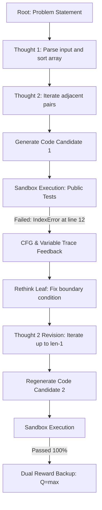

# RethinkMCTS: Cải thiện khả năng suy luận của LLM trong sinh mã nguồn bằng Monte Carlo Tree Search với phản hồi từ kiểm thử tự động (7B–14B)

Dự án nghiên cứu Tiểu luận Chuyên ngành / Luận văn Tốt nghiệp: Triển khai hoàn chỉnh thuật toán **RethinkMCTS** (*"RethinkMCTS: Refining Erroneous Thoughts in Monte Carlo Tree Search for Code Generation"*, arXiv:2409.09584v2) với kiến trúc **Modular Monolith + Ports & Adapters**, được tối ưu hóa đặc biệt cho phân khúc **mô hình nhỏ ($\le$ 14B)** như `Qwen2.5-Coder-7B` (chạy trên Ollama cục bộ) và `Qwen2.5-Coder-14B` (chạy trên Remote vLLM/Modal).

Tài liệu đặc tả kỹ thuật chi tiết: [docs/rethinkmcts_small_model_spec.md](docs/rethinkmcts_small_model_spec.md).

---

## Mục lục

1. [Tổng quan &amp; Động lực Nghiên cứu](#1-tổng-quan--động-lực-nghiên-cứu)
2. [Kiến trúc Hệ thống (Ports &amp; Adapters)](#2-kiến-trúc-hệ-thống-ports--adapters)
3. [Nguyên lý Toán học &amp; Cơ chế Thuật toán](#3-nguyên-lý-toán-học--cơ-chế-thuật-toán)
4. [Cài đặt Môi trường](#4-cài-đặt-môi-trường)
5. [Bộ Dữ liệu Chuẩn (HumanEval &amp; APPS)](#5-bộ-dữ-liệu-chuẩn-humaneval--apps)
6. [Hướng dẫn Sử dụng CLI (`rethink`)](#6-hướng-dẫn-sử-dụng-cli-rethink)
7. [Kịch bản Chạy Mẫu (Quickstarts)](#7-kịch-bản-chạy-mẫu-quickstarts)
8. [Cấu hình Hệ thống (YAML Configs)](#8-cấu-hình-hệ-thống-yaml-configs)
9. [Kiểm thử Tự động (36/36 Tests Passed)](#9-kiểm-thử-tự-động-3636-tests-passed)
10. [Xử lý Sự cố &amp; FAQs](#10-xử-lý-sự-cố--faqs)

---

## 1. Tổng quan & Động lực Nghiên cứu

Trong sinh mã nguồn tự động, các phương pháp truyền thống như **Direct Sampling**, **Best-of-N**, hay **Self-Refine** thường gặp phải các hạn chế nghiêm trọng khi chạy trên mô hình nhỏ ($\le$ 14B):

- **Sửa mù quáng (Blind refinement):** Gửi toàn bộ mã lỗi và thông báo lỗi chung chung vào prompt khiến mô hình bị ảo giác (hallucination) và lặp lại lỗi cũ.
- **Tốn kém tài nguyên:** Sinh lại toàn bộ chương trình từ đầu làm tiêu tốn lượng token khổng lồ.
- **Thiếu kiểm chứng khách quan:** Không có cơ chế cô lập giữa tập kiểm thử đề bài (public tests) và tập kiểm thử ẩn (hidden tests), dẫn đến nguy cơ gian lận kiểm thử (test leakage/overfitting).

**RethinkMCTS** giải quyết triệt để các vấn đề này bằng cách:

1. **Tìm kiếm ở mức tư duy (Thought-Level MCTS):** Chia nhỏ bài toán thành các bước tư duy thuật toán (như tiền xử lý, cấu trúc dữ liệu, điều kiện biên) thay vì tìm kiếm trên từng token hoặc từng dòng code.
2. **Truy vết lỗi sâu (Execution-Guided CFG & Variable Tracing):** Khi chương trình thực thi thất bại trên Sandbox, hệ thống dùng phân tích Bytecode để tái dựng đồ thị luồng điều khiển (Basic-Block CFG) và chụp ảnh trạng thái biến runtime.
3. **Cơ chế "Quay đầu đúng chỗ" (Leaf Revision):** Thay vì vứt bỏ toàn bộ cây tìm kiếm, hệ thống xác định bước suy luận sai lầm cuối cùng (leaf node) và thay thế nó bằng một suy luận đã hiệu chỉnh (revised thought) dựa trên phản hồi lỗi thực tế, bảo tồn toàn bộ chuỗi tư duy đúng đắn trước đó.



---

## 2. Kiến trúc Hệ thống (Ports & Adapters)

Mã nguồn được tổ chức theo kiến trúc **Clean Architecture / Hexagonal Architecture (Ports & Adapters)** trong thư mục [`src/rethink_mcts/`](src/rethink_mcts/):

```text
TLCN/
├── configs/                     # Cấu hình chuẩn YAML theo từng môi trường
│   ├── apps_7b.yaml             # Cấu hình benchmark APPS với Ollama 7B
│   ├── humaneval_7b.yaml        # Cấu hình benchmark HumanEval với Ollama 7B
│   ├── ollama_7b.yaml           # Cấu hình Ollama 7B mặc định
│   ├── remote_14b.yaml          # Cấu hình Remote Endpoint 14B (vLLM / Modal)
│   ├── paper_reference.yaml     # Cấu hình chuẩn đối chiếu tham số bài báo gốc
│   └── smoke_mock.yaml          # Cấu hình kiểm thử Scenario Mock (0 chi phí API)
│
├── deploy/
│   └── sandbox/Dockerfile       # Dockerfile unprivileged cho worker cô lập
│
├── docs/
│   └── rethinkmcts_small_model_spec.md # Bản đặc tả kỹ thuật chi tiết Milestones M0-M7
│
├── prompts/
│   └── compact_v1/              # Jinja2 prompt templates tối ưu cho context mô hình nhỏ
│       ├── expand.jinja         # Prompt đề xuất các thought tiếp theo
│       ├── generate_code.jinja  # Prompt sinh mã hoàn chỉnh từ chuỗi thought
│       ├── rethink.jinja        # Prompt tự hiệu chỉnh thought dựa trên trace phản hồi
│       ├── self_eval.jinja      # Prompt mô hình tự đánh giá giải pháp (Critic)
│       └── analyze_block.jinja  # Prompt phân tích block lỗi runtime
│
├── src/rethink_mcts/            # Package mã nguồn chính
│   ├── domain/                  # Lõi nghiệp vụ độc lập không phụ thuộc thư viện ngoài
│   │   ├── problem.py           # Phân tách PublicProblem và HiddenProblem
│   │   ├── candidate.py         # ProgramCandidate (bất biến) và ExecutionSummary
│   │   ├── tree.py              # Cây MCTS, SearchNode và vòng đời ThoughtRevision
│   │   ├── feedback.py          # FeedbackReport, CFG block và Trace snapshot
│   │   ├── budget.py            # Quản lý và kiểm toán tài nguyên (calls, tokens, time)
│   │   ├── events.py            # Hệ thống sự kiện kiểm toán (audit trail)
│   │   └── errors.py            # Phân cấp ngoại lệ domain
│   │
│   ├── ports/                   # Interfaces trừu tượng (Ports)
│   │   ├── models.py            # ModelGateway, ThoughtProposer, CodeGenerator, Refiner
│   │   ├── execution.py         # PublicExecutor, SandboxRunner
│   │   ├── datasets.py          # PublicProblemSource, HiddenSuiteSource
│   │   └── storage.py           # RunStore, CacheStore
│   │
│   ├── policies/                # Các thuật toán & công thức toán học
│   │   ├── selection.py         # P-UCB Equation (Eq. 1 & 2)
│   │   ├── backup.py            # MaxBackup (Q = max child/revision)
│   │   ├── reward.py            # Paper DualReward (Public tests + Conditional Critic)
│   │   ├── prior.py             # PriorPolicy chuẩn hóa điểm & deduplication
│   │   ├── stopping.py          # Tiêu chí dừng tìm kiếm và budget guards
│   │   └── final_selection.py   # Lựa chọn ứng viên tối ưu trước khi chấm hidden
│   │
│   ├── adapters/                # Triển khai cụ thể các Ports (Adapters)
│   │   ├── llm/                 # HttpModelGateway (OpenAI-compatible), Mock, Parsers
│   │   ├── execution/           # Bytecode CFG, Dynamic Tracer, Subprocess/Docker Runner
│   │   ├── datasets/            # HumanEval, APPS, CodeContests, JSONL adapters
│   │   └── storage/             # FileSystemRunStore (Atomic writes, checkpoints)
│   │
│   ├── application/             # Điều phối Use Cases (Orchestration)
│   │   ├── search.py            # SearchEngine: Vòng lặp MCTS chính
│   │   ├── evaluate.py          # CandidateEvaluator: Đánh giá trên test công khai
│   │   ├── feedback.py          # FeedbackService: Tạo phản hồi lỗi từ CFG & Trace
│   │   ├── judge.py             # HiddenJudge: Chấm độc lập trên tập test ẩn
│   │   ├── prepare.py           # DatasetPreparationService: Chuẩn bị kho dữ liệu
│   │   ├── report.py            # MetricsReporter: Báo cáo thực nghiệm & Pass@1
│   │   └── baselines.py         # Direct Sampling & Best-of-N baselines
│   │
│   ├── bootstrap.py             # Nơi duy nhất ráp Dependency Injection từ Config
│   ├── cli.py                   # Giao diện dòng lệnh chính thức: `rethink <subcommand>`
│   └── config.py                # Pydantic v2 strict configuration schema
│
├── tests/
│   ├── unit/                    # Kiểm tra toán P-UCB, Q=max, Dual Reward, Parsers
│   ├── contracts/               # Kiểm tra CFG, Tracing, Leaf Revision, Anti-Leakage
│   ├── acceptance/              # Scenarios A, B, C, D (Watermelon, Anti-Oracle, Swap)
│   └── fixtures/                # Dữ liệu test mẫu tách biệt public & hidden
│
├── pyproject.toml               # Cấu hình cài đặt package & lệnh CLI `rethink`
└── requirements.txt             # Danh sách thư viện phụ thuộc
```

---

## 3. Nguyên lý Toán học & Cơ chế Thuật toán

### 3.1. Thuật toán Chọn Nhánh P-UCB (Selection - Eq. 1 & 2)

Trong giai đoạn Selection, hệ thống chọn node con $u$ từ node cha $p$ để duyệt sâu xuống cây dựa trên điểm P-UCB:

$$
\text{Score}(u) = Q(u) + c \cdot P(u) \cdot \frac{\sqrt{N(p)}}{1 + N(u)} \cdot \left[c_{base} + \log\left(\frac{N(p) + c_{base} + 1}{c_{base}}\right)\right]
$$

Trong đó:

- $Q(u)$: Giá trị chất lượng của node $u$ (với node chưa duyệt, $Q$ khởi tạo từ giá trị nhỏ nhất của các node anh em đã duyệt, mặc định $0.0$).
- $P(u)$: Xác suất tiên nghiệm (Prior reasonableness) do LLM chấm cho thought $u$, đã được chuẩn hóa $\sum P(u) = 1$.
- $N(p), N(u)$: Số lượt truy cập của node cha và node con.
- $c, c_{base}$: Các hằng số điều chỉnh mức độ cân bằng giữa Khai phá (Exploitation) và Khám phá (Exploration) (mặc định $c = 4.0, c_{base} = 10.0$).

### 3.2. Lan truyền Ngược $Q = \max$ (Max Backup)

Khác với MCTS truyền thống dùng trung bình cộng (Mean Backup), RethinkMCTS sử dụng **Max Backup**:

$$
Q(p) = \max_{u \in \text{Children}(p)} Q(u)
$$

*Lý do:* Trong bài toán lập trình, ta chỉ cần tìm ra **ít nhất một lời giải đúng 100%**. Việc dùng Mean Backup sẽ vô tình phạt một hướng đi xuất sắc chỉ vì các lần thử sai lầm trước đó của nhánh này.

### 3.3. Hàm Thưởng Kép (Paper Dual Reward)

Hàm thưởng kết hợp giữa kết quả thực thi kiểm thử khách quan và đánh giá của mô hình (Critic):

$$
R = w_{\text{test}} \cdot V_{\text{test}} + w_{\text{llm}} \cdot V_{\text{llm}}
$$

Trong đó:

- $V_{\text{test}} = \frac{\text{Passed Public Tests}}{\text{Total Public Tests}}$.
- $V_{\text{llm}} \in [0.0, 1.0]$: Điểm tự đánh giá của mô hình (Self-Evaluation).
- **Quy tắc điều kiện bắt buộc (§4 của paper):** Critic $V_{\text{llm}}$ **chỉ được gọi khi và chỉ khi** chương trình đã vượt qua 100% các public tests ($V_{\text{test}} = 1.0$). Nếu chương trình chưa pass hết public test, $V_{\text{llm}} = 0.0$ nhằm tránh lãng phí token vào các lời giải còn lỗi cú pháp hoặc sai logic cơ bản.

### 3.4. Vòng đời Hiệu chỉnh Tư duy (ThoughtRevision Lifecycle)

Khi một node lá (leaf node) sinh mã thất bại trên public tests:

1. Node lá không bị xóa, và đường đi từ root đến cha của nó (`parent_path`) được giữ nguyên bất biến.
2. Hệ thống sinh ra một `ThoughtRevision` mới thay thế thought cũ tại lá.
3. Node lá được cấp số lần rethink tối đa (`max_rethinks_per_node = 1`). Khi sinh lại mã thành công, reward mới sẽ được backup ngược lên tổ tiên, ghi đè $Q$ cũ nếu đạt điểm cao hơn.

### 3.5. Chống Rò rỉ Dữ liệu Kiểm thử (Test Leakage Prevention)

Để đảm bảo tính trung thực khoa học, hệ thống tách rời hoàn toàn:

- **`PublicProblem`**: Chỉ chứa đề bài và các ca kiểm thử công khai (doctest/ví dụ mẫu). Quá trình tìm kiếm MCTS chỉ được tiếp cận đối tượng này.
- **`HiddenProblem`**: Chứa toàn bộ test ẩn (hidden suite) và official test harness của benchmark. Chỉ được mở bởi tiến trình độc lập `HiddenJudge` sau khi MCTS đã đóng băng và lưu cố định lời giải duy nhất (`selected.py`).

---

## 4. Cài đặt Môi trường

### 4.1. Yêu cầu Hệ thống

- Hệ điều hành: macOS, Linux, hoặc Windows (WSL2).
- Python: **Phiên bản >= 3.10** (khuyến nghị Python 3.11).
- Ollama (nếu chạy mô hình 7B cục bộ): Đã cài đặt [Ollama](https://ollama.com/) và tải model `qwen2.5-coder:7b`.

### 4.2. Khởi tạo Môi trường Ảo

```bash
# Clone repository
git clone <repo-url> TLCN
cd TLCN

# Tạo môi trường ảo
python3 -m venv .venv
source .venv/bin/activate

# Nâng cấp pip và cài đặt package ở chế độ editable
python -m pip install --upgrade pip
pip install -e .
```

Sau khi cài đặt, lệnh CLI `rethink` sẽ có sẵn trên toàn hệ thống.

---

## 5. Bộ Dữ liệu Chuẩn (HumanEval & APPS)

Hệ thống hỗ trợ 2 bộ dữ liệu chuẩn chính thức của bài báo gốc:

### 5.1. HumanEval (164 bài toán hàm Python của OpenAI)

- **Cấu trúc:** Mỗi bài toán gồm docstring mô tả, chữ ký hàm (`entry_point`), các doctests công khai (`given_tests`) và bộ kiểm thử ẩn chính thức (`check(candidate)`).
- **Public Tests:** Tự động trích xuất từ doctest trong docstring (ví dụ: `assert has_close_elements([1.0, 2.0, 3.0], 0.5) == False`).
- **Hidden Tests:** Hàm `check(candidate)` chứa từ 5 đến 20 ca kiểm thử biên khắc nghiệt.

### 5.2. APPS (Automated Programming Progress Standard)

- **Cấu trúc:** Gồm 3 phân tầng độ khó: *Introductory* (nhập môn), *Interview* (phỏng vấn), *Competition* (thi đấu Olympic/Codeforces).
- Hỗ trợ cả 2 phương thức thực thi: Standard I/O (`stdin`/`stdout`) và Call-based (`fn_name`).
- Tự động tách 2 test cases đầu làm Public Examples, toàn bộ test cases còn lại được đưa vào Hidden Suite.

### 5.3. Chuẩn bị Dữ liệu Tự động qua CLI (`rethink prepare`)

Hệ thống cung cấp lệnh `rethink prepare` để tự động tải, chuẩn hóa và xuất dữ liệu thành 2 kho riêng biệt:

```bash
# Chuẩn bị toàn bộ 164 bài toán HumanEval:
rethink prepare --dataset humaneval

# Chuẩn bị 50 bài toán mẫu từ benchmark APPS:
rethink prepare --dataset apps --limit 50
```

Dữ liệu được lưu tại thư mục `prepared/<dataset>/`:

```text
prepared/humaneval/
├── manifest.json                  # Hash dữ liệu, số lượng bài, metadata
├── public/problems.jsonl          # Kho bài toán công khai cho MCTS Search
└── judge/suites/python_0.json     # Kho test ẩn dành riêng cho Hidden Judge
```

---

## 6. Hướng dẫn Sử dụng CLI (`rethink`)

Lệnh `rethink` cung cấp giao diện quản lý toàn diện từ kiểm tra hệ thống, chuẩn bị dữ liệu, tìm kiếm lời giải, chấm điểm ẩn cho đến xuất báo cáo.

```text
usage: rethink [-h] {prepare,doctor,solve,judge,report} ...
```

### 6.1. `rethink doctor` (Kiểm tra sức khỏe hệ thống)

Kiểm tra cú pháp cấu hình YAML, độ trễ/kết nối đến mô hình (Ollama hoặc Remote URL), danh sách model và kiểm thử khả năng chạy code của Sandbox:

```bash
rethink doctor --config configs/humaneval_7b.yaml
```

*Kết quả mẫu:*

```text
RethinkMCTS Doctor Check
Config: configs/humaneval_7b.yaml
✓ Config syntax and schema validation passed
  Model Transport: openai_compatible
  Base URL: http://localhost:11434/v1
  Model Name: qwen2.5-coder:7b
  Execution Backend: trusted_fixture
✓ Endpoint http://localhost:11434/v1 reachable (status 200)
✓ Model 'qwen2.5-coder:7b' confirmed available on endpoint
✓ Trusted fixture executor verified (worker probe passed)
System check completed successfully.
```

### 6.2. `rethink prepare` (Chuẩn hóa Dataset)

Phân tách dữ liệu thô thành kho `public/` và `judge/`:

```bash
rethink prepare --dataset humaneval --output prepared/humaneval
rethink prepare --dataset apps --limit 50 --output prepared/apps
```

### 6.3. `rethink solve` (Thực thi Tìm kiếm Lời giải)

Chạy thuật toán Thought-Level MCTS trên một bài toán công khai:

```bash
rethink solve \
  --config configs/humaneval_7b.yaml \
  --problem tests/fixtures/humaneval_0_public.json \
  --output-dir runs/my_run
```

*Các tùy chọn hữu ích:*

- `--endpoint <url>`: Ghi đè URL endpoint của model (ví dụ: `http://localhost:8000/v1`).
- `--model <name>`: Ghi đè tên model (ví dụ: `Qwen/Qwen2.5-Coder-14B-Instruct`).
- `--output-dir <dir>`: Thư mục lưu vết tìm kiếm và chương trình hoàn chỉnh (`selected.py`).

### 6.4. `rethink judge` (Chấm điểm Độc lập trên Test Ẩn)

Chấm điểm chương trình `selected.py` đã đóng băng sau tìm kiếm với tập test ẩn:

```bash
rethink judge \
  --run runs/my_run \
  --hidden tests/fixtures/humaneval_0_hidden.json
```

### 6.5. `rethink report` (Tổng hợp Báo cáo Thực nghiệm)

Tạo bảng tổng kết số liệu tài nguyên (model calls, code attempts, rethink attempts, runtime) và tính toán chỉ số Pass@1:

```bash
rethink report --run runs/my_run
```

Kết quả được xuất ra file Markdown [`summary.md`](file://runs/my_run/reports/summary.md) và JSON [`summary.json`](file://runs/my_run/reports/summary.json).

---

## 7. Kịch bản Chạy Mẫu (Quickstarts)

### Kịch bản 1: Chạy Thử Nghiệm Nhanh Ngoại Tuyến (Offline Mock - 0 Chi phí)

Kịch bản này sử dụng `ScenarioMockLLM` giả lập hành vi của bài báo, cho phép bạn kiểm tra toàn bộ luồng MCTS, Rethink Loop và Sandbox trong 2 giây mà không cần GPU hay mạng Internet:

```bash
# 1. Kiểm tra cấu hình mock
rethink doctor --config configs/smoke_mock.yaml

# 2. Giải bài toán Watermelon
rethink solve --config configs/smoke_mock.yaml \
              --problem tests/fixtures/watermelon_public.json \
              --output-dir runs/smoke_demo

# 3. Chấm điểm với Hidden Judge
rethink judge --run runs/smoke_demo \
              --hidden tests/fixtures/watermelon_hidden.json

# 4. Xuất báo cáo
rethink report --run runs/smoke_demo
```

---

### Kịch bản 2: Chạy Thực Tế với Ollama 7B Cục Bộ (`HumanEval/0`)

Sử dụng mô hình mã nguồn mở `qwen2.5-coder:7b` chạy trực tiếp trên máy của bạn qua Ollama:

```bash
# Bước 1: Khởi động Ollama và tải model (nếu chưa có)
ollama pull qwen2.5-coder:7b

# Bước 2: Kiểm tra kết nối
rethink doctor --config configs/humaneval_7b.yaml

# Bước 3: Chuẩn bị dữ liệu HumanEval
rethink prepare --dataset humaneval

# Bước 4: Chạy MCTS giải bài HumanEval/0
rethink solve --config configs/humaneval_7b.yaml \
              --problem tests/fixtures/humaneval_0_public.json \
              --output-dir runs/ollama_humaneval_demo

# Bước 5: Chấm điểm bằng Hidden Judge
rethink judge --run runs/ollama_humaneval_demo \
              --hidden tests/fixtures/humaneval_0_hidden.json

# Bước 6: Xem báo cáo
rethink report --run runs/ollama_humaneval_demo
cat runs/ollama_humaneval_demo/reports/summary.md
```

---

### Kịch bản 3: Chạy Thực Tế với Remote Endpoint 14B (vLLM / Modal / Cloud GPU)

Khi triển khai trên máy chủ GPU từ xa (chạy vLLM hoặc Modal):

```bash
rethink solve \
  --config configs/remote_14b.yaml \
  --endpoint "https://your-gpu-instance.com/v1" \
  --model "Qwen/Qwen2.5-Coder-14B-Instruct" \
  --problem tests/fixtures/apps_0_public.json \
  --output-dir runs/remote_apps_run
```

---

## 8. Cấu hình Hệ thống (YAML Configs)

Các file cấu hình trong thư mục [`configs/`](configs/) tuân thủ schema nghiêm ngặt được định nghĩa trong [`src/rethink_mcts/config.py`](src/rethink_mcts/config.py):

| Nhóm Tham Số          | Tham Số Chính              | Ý Nghĩa & Khuyến Nghị                                                               |
| :---------------------- | :--------------------------- | :-------------------------------------------------------------------------------------- |
| **`model`**     | `transport`                | `openai_compatible` (cho Ollama, vLLM, OpenAI) hoặc `mock`.                        |
|                         | `base_url`                 | URL của endpoint (ví dụ:`http://localhost:11434/v1`).                              |
|                         | `model`                    | Tên model định danh (ví dụ:`qwen2.5-coder:7b`).                                  |
| **`search`**    | `width`                    | Độ rộng cây (số lượng thought đề xuất tại mỗi bước, khuyến nghị: 2–3). |
|                         | `max_depth`                | Độ sâu tối đa của cây suy luận (khuyến nghị: 3–4 bước).                    |
|                         | `c`, `c_base`            | Tham số P-UCB ($c=4.0, c_{base}=10.0$ theo bài báo).                               |
|                         | `max_rethinks_per_node`    | Số lần tối đa cho phép node lá tự sửa lỗi (mặc định: 1).                    |
| **`reward`**    | `test_weight`              | Trọng số kiểm thử public ($w_{\text{test}} = 0.8$).                               |
|                         | `llm_weight`               | Trọng số điểm mô hình tự đánh giá ($w_{\text{llm}} = 0.2$).                 |
| **`budget`**    | `max_code_generations`     | Giới hạn tối đa số lần sinh code trong 1 lượt tìm kiếm (ví dụ: 4–8).       |
|                         | `max_model_calls`          | Giới hạn tối đa số lần gọi API (ví dụ: 20–30).                                |
|                         | `max_wall_seconds`         | Timeout toàn bộ phiên tìm kiếm (ví dụ: 300s).                                    |
| **`execution`** | `backend`                  | `trusted_fixture` (chạy subprocess an toàn) hoặc `docker` (container cô lập).  |
|                         | `per_test_timeout_seconds` | Giới hạn thời gian chạy cho mỗi test case (2.0s – 4.0s).                          |

---

## 9. Kiểm thử Tự động (36/36 Tests Passed)

Toàn bộ hệ thống được bảo vệ bởi bộ kiểm thử tự động nghiêm ngặt gồm **36 bài test** bao phủ các tầng kiến trúc:

```bash
pytest -v
```

```text
============================== test session starts ==============================
collected 36 items

tests/acceptance/test_scenario_a.py::test_scenario_a_watermelon_provenance PASSED [  2%]
tests/acceptance/test_scenario_b.py::test_scenario_b_anti_oracle_hidden_fail PASSED [  5%]
tests/acceptance/test_scenario_c.py::test_scenario_c_endpoint_swap_without_code_changes PASSED [  8%]
tests/acceptance/test_scenario_d.py::test_scenario_d_budget_cap_and_checkpoint PASSED [ 11%]
tests/contracts/test_cfg_and_trace.py::test_i15_cfg_basic_blocks_edges_and_line_spans PASSED [ 13%]
tests/contracts/test_cfg_and_trace.py::test_i16_mutable_container_mutation_does_not_mutate_before_snapshot PASSED [ 16%]
tests/contracts/test_cfg_and_trace.py::test_i17_recursion_and_repeated_loop_block_frames_and_sequence PASSED [ 19%]
tests/contracts/test_cfg_and_trace.py::test_i18_tracer_syntax_error_returns_degraded PASSED [ 22%]
tests/contracts/test_datasets_and_leakage.py::test_i22_adversarial_hidden_sentinel_never_leaks_to_public PASSED [ 25%]
tests/contracts/test_datasets_and_leakage.py::test_i23_function_mode_harness_preserves_function_call PASSED [ 27%]
tests/contracts/test_datasets_and_leakage.py::test_i24_mismatched_test_array_lengths_raises_error PASSED [ 30%]
tests/contracts/test_rethink_and_tree.py::test_i04_rethink_leaf_reset_and_ancestor_receives_both PASSED [ 33%]
tests/contracts/test_rethink_and_tree.py::test_i05_rethink_lower_reward_keeps_ancestor_max PASSED [ 36%]
tests/contracts/test_rethink_and_tree.py::test_i06_rethink_rejects_node_with_children PASSED [ 38%]
tests/contracts/test_rethink_and_tree.py::test_i08_parent_path_preserves_all_ancestor_thoughts PASSED [ 41%]
tests/contracts/test_rethink_and_tree.py::test_i10_strict_budget_cutoff_stops_generation PASSED [ 44%]
tests/unit/test_humaneval_and_apps.py::test_humaneval_parsing_and_execution PASSED [ 47%]
tests/unit/test_humaneval_and_apps.py::test_apps_parsing_and_execution PASSED [ 50%]
tests/unit/test_judge.py::test_u18_hidden_suite_empty_returns_incomplete_or_zero PASSED [ 52%]
tests/unit/test_parsers_and_gateway.py::test_u14_proposals_json_not_tricked_by_explanation_numbers PASSED [ 55%]
tests/unit/test_parsers_and_gateway.py::test_u15_multiple_conflicting_code_blocks_raises PASSED [ 58%]
tests/unit/test_parsers_and_gateway.py::test_u16_url_normalization_handles_various_formats PASSED [ 61%]
tests/unit/test_parsers_and_gateway.py::test_u17_unsupported_config_field_fail_fast PASSED [ 63%]
tests/unit/test_policies.py::test_u01_p_ucb_exact_computation PASSED     [ 66%]
tests/unit/test_policies.py::test_u02_unvisited_siblings_bootstrap PASSED [ 69%]
tests/unit/test_policies.py::test_u03_max_backup_vs_mean PASSED          [ 72%]
tests/unit/test_policies.py::test_u04_v_test_partial_critic_skipped PASSED [ 75%]
tests/unit/test_policies.py::test_u05_public_full_pass_reference_critic_range PASSED [ 77%]
tests/unit/test_policies.py::test_u06_public_full_pass_compact_critic_range PASSED [ 80%]
tests/unit/test_policies.py::test_u07_no_clamping_on_extended_weights PASSED [ 83%]
tests/unit/test_policies.py::test_u08_empty_public_suite_no_tests PASSED [ 86%]
tests/unit/test_policies.py::test_u09_prior_normalization PASSED         [ 88%]
tests/unit/test_policies.py::test_u10_prior_fallback_uniform_on_zero_total PASSED [ 91%]
tests/unit/test_policies.py::test_u11_thought_dedup_and_mass_aggregation PASSED [ 94%]
tests/unit/test_policies.py::test_u12_final_selection_from_archive PASSED [ 97%]
tests/unit/test_policies.py::test_u13_max_reward_vs_public_first PASSED  [100%]

============================== 36 passed in 0.91s ==============================
```

- **Unit Tests (`tests/unit/`):** Kiểm tra tính toán giải tích công thức P-UCB (U01), gán giá trị khởi tạo cho node chưa duyệt (U02), Max Backup so với Mean (U03), điều kiện kích hoạt Critic (U04–U07), chuẩn hóa prior (U09–U11), parse output và trích xuất code (U14–U15), chuẩn hóa URL gateway (U16), parser HumanEval & APPS.
- **Contract Tests (`tests/contracts/`):** Kiểm tra cấu trúc Basic Block và Branch Edge từ Bytecode (I15), tính bất biến của snapshot biến qua các vòng lặp/đệ quy (I16–I17), vòng đời thay thế lá của Rethink (I04–I06), chống rò rỉ dữ liệu test ẩn (I22), cơ chế cắt ngân sách nghiêm ngặt (I10).
- **Acceptance Tests (`tests/acceptance/`):** Scenarios A (Watermelon provenance), B (Phát hiện lời giải gian lận), C (Đổi endpoint không cần sửa mã nguồn), D (Cắt budget và resume).

---

## 10. Xử lý Sự cố & FAQs

**1. Lỗi: `ConnectionRefusedError: [Errno 61] Connection refused` khi chạy `rethink doctor` hoặc `solve`:**

- *Nguyên nhân:* Endpoint mô hình cục bộ chưa được khởi động.
- *Khắc phục:* Nếu dùng Ollama, hãy mở ứng dụng Ollama hoặc chạy lệnh `ollama serve` trên terminal. Đảm bảo cổng `11434` đang lắng nghe.

**2. Lỗi: `Model 'qwen2.5-coder:7b' not listed in /models`:**

- *Nguyên nhân:* Model chưa được tải về máy.
- *Khắc phục:* Chạy lệnh `ollama pull qwen2.5-coder:7b`.

**3. Tại sao khi giải bài toán, MCTS chỉ chạy 1-2 lần rồi dừng?**

- *Giải thích:* Kiểm tra tham số `budget.max_code_generations` và `budget.max_search_iterations` trong file cấu hình YAML. Đối với demo nhanh, các giá trị này được đặt nhỏ (4–8 lượt) để tiết kiệm thời gian. Khi chạy benchmark chính thức, bạn có thể tăng lên `max_code_generations: 16`.

**4. Mã nguồn có hỗ trợ chạy trên Docker container để đảm bảo an toàn tuyệt đối không?**

- *Có:* Bạn chỉ cần chuyển `execution.backend: docker` trong cấu hình YAML và build image worker từ [`deploy/sandbox/Dockerfile`](deploy/sandbox/Dockerfile) bằng lệnh:
  ```bash
  docker build -t rethink-worker:py311 deploy/sandbox/
  ```

---

## Tài liệu Tham khảo

1. **RethinkMCTS Paper:** *"RethinkMCTS: Refining Erroneous Thoughts in Monte Carlo Tree Search for Code Generation"*, arXiv:2409.09584v2, 2025. [PDF đính kèm trong repository](Rethink.pdf).
2. **HumanEval Benchmark:** Mark Chen et al., *"Evaluating Large Language Models Trained on Code"*, OpenAI, 2021.
3. **APPS Benchmark:** Dan Hendrycks et al., *"Measuring Coding Challenge Competence With APPS"*, NeurIPS 2021.
4. **AlphaCode & CodeContests:** Yujia Li et al., *"Competition-level code generation with AlphaCode"*, Science 2022.
