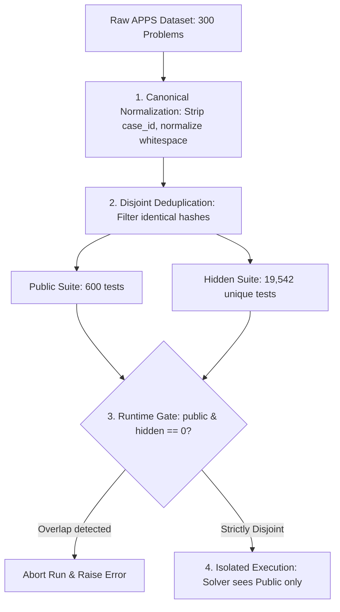

# BÁO CÁO KỸ THUẬT: XỬ LÝ DỮ LIỆU & BẢO TOÀN TÍNH LIÊM CHÍNH TRONG THỰC NGHIỆM SINH MÃ NGUỒN

> **Tài liệu tham chiếu học thuật cho Tiểu luận Chuyên ngành / Luận văn Tốt nghiệp**  
> **Chủ đề:** *Ngăn chặn rò rỉ dữ liệu kiểm thử (Data Contamination Prevention) và Chuẩn hóa Bộ dữ liệu Đánh giá trong RethinkMCTS trên Mô hình Ngôn ngữ Nhỏ (SLM)*  
> **Ngày cập nhật:** 25/09/2026

---

## 1. Đặt vấn đề & Động lực Học thuật (Context & Motivation)

Trong các bài toán tự động sinh mã nguồn (Code Generation) kết hợp tìm kiếm cây Monte Carlo (MCTS như **RethinkMCTS**), quy trình đánh giá dựa trên hai không gian kiểm thử hoàn toàn tách biệt:

1. **Tập kiểm thử công khai (Public Test Suite $\mathcal{D}_{\text{public}}$):**
   - Đóng vai trò là **tín hiệu phản hồi từ môi trường (Environment Feedback)**.
   - Được dùng trong quá trình tìm kiếm để tính hàm phần thưởng scalar (Reward), ghi nhận vết thực thi luồng điều khiển (Bytecode CFG & Variable Trace), thực hiện phân tích lỗi mức khối (Block-level Analysis), và kích hoạt cơ chế hiệu chỉnh tư duy (Leaf Rethink).
2. **Tập kiểm thử ẩn (Hidden / Private Test Suite $\mathcal{D}_{\text{hidden}}$):**
   - Đóng vai trò là **chuẩn đo lường độc lập (Ground-Truth Evaluator)**.
   - Dùng để đo lường độ chính xác tổng quát hóa thực sự của giải pháp cuối cùng qua các chỉ số khoa học: **Pass@1** (tỷ lệ bài giải đúng 100% test ẩn) và **Mean Hidden Pass Rate** (tỷ lệ phần trăm test ẩn vượt qua).

### Rủi ro cốt lõi: Rò rỉ dữ liệu kiểm định (Test Leakage / Contamination)
Nguyên tắc vàng của phương pháp luận thực nghiệm: **Tập Hidden phải hoàn toàn độc lập và không bao giờ được phép trùng lặp nội dung với tập Public**. Nếu có sự giao thoa:
$$\mathcal{D}_{\text{public}} \cap \mathcal{D}_{\text{hidden}} \neq \emptyset$$
khi đó mô hình sinh mã chỉ cần "học vẹt" (overfitting) hoặc sửa mã để vượt qua Public Tests thì mặc nhiên đã vượt qua một phần Hidden Tests. Hiện tượng này làm **thổi phồng độ chính xác giả tạo (metric inflation)**, làm sai lệch phân tích tương quan giữa các phương pháp (ví dụ: ngộ nhận MCTS hay Adaptive Feedback vượt trội hơn Direct/BoN), và **hủy hoại tính liêm chính học thuật (academic integrity)** của đề tài.

---

## 2. Vấn đề Phát hiện trong Dữ liệu Gốc (The Naive Split Flaw)

Trong các nghiên cứu trước đây trên bộ dữ liệu **APPS** (*Hendrycks et al., NeurIPS 2021*), mỗi bài toán chứa một danh sách các cặp kiểm thử trong trường `input_output`. Quy ước phân chia phổ biến thường là cắt lát danh sách ngây thơ (naive slicing):
- Lấy $k$ ca kiểm thử đầu tiên (thường $k=2$) làm Public Tests.
- Lấy toàn bộ các ca kiểm thử còn lại ($k \ge 3$) làm Hidden Tests.

### Phát hiện thực tế tại dự án:
Khi rà soát sâu đến mức từng byte dữ liệu (thay vì chỉ so sánh định danh `case_id` vốn luôn khác nhau do sinh tự động), chúng tôi phát hiện một khiếm khuyết nghiêm trọng trong bộ dữ liệu gốc:
- Các tác giả đề bài trong APPS thường lặp lại chính các ví dụ mẫu (sample test cases) ở phần sau của danh sách test kiểm thử chính thức.
- **Thống kê định lượng trên tập 300 bài APPS khảo sát (100 Introductory, 100 Interview, 100 Competition):**
  - Có tới **13 ca kiểm thử ẩn trùng lặp hoàn toàn 100% về nội dung** với các ca kiểm thử công khai.
  - Sự trùng lặp này xuất hiện trên **8 bài toán cụ thể**, bao gồm cả những bài trong tập Introductory (ví dụ: `apps_2`, `apps_4073`).
- **Hậu quả nếu không xử lý:**
  - Nếu áp dụng cách phân chia ngây thơ, ít nhất 8 bài toán sẽ bị rò rỉ dữ liệu nghiêm trọng. Điểm Pass Rate của các bài này sẽ bị thiên vị (biased), không phản ánh năng lực khái quát hóa của mô hình ngôn ngữ.

---

## 3. Giải pháp Kỹ thuật & Đóng góp Phương pháp luận (Methodology)

Để giải quyết triệt để vấn đề trên và thiết lập một quy chuẩn thực nghiệm nghiêm ngặt, chúng tôi đã triển khai hệ thống xử lý dữ liệu 4 lớp bảo vệ:



### Cơ chế 1: Chuẩn hóa thực thể & Khử trùng lặp nội dung (Canonical Normalization & Hash Deduplication)
Trong module [`src/rethink_mcts/adapters/datasets/apps.py`](file:///Users/kotori/Documents/TLCN/src/rethink_mcts/adapters/datasets/apps.py):
1. Mỗi ca kiểm thử được đưa về dạng biểu diễn chuẩn tắc (Canonical representation): loại bỏ hoàn toàn các trường siêu dữ liệu ngẫu nhiên (`case_id`), chuẩn hóa định dạng chuỗi (`\n`), đồng nhất kiểu dữ liệu tham số hàm.
2. Hàm băm nội dung bất biến:
   $$H(c) = \text{SHA256}\Big(\text{JSON}_{\text{sorted\_keys}}(\text{asdict}(c) \setminus \{\text{"case\_id"}\})\Big)$$
3. Thuật toán phân hoạch tập rời rạc tuyệt đối:
   - Chọn 2 ca đầu tiên làm tập công khai: $\mathcal{D}_{\text{public}} = \{c_1, c_2\}$.
   - Tập kiểm thử ẩn được lọc nghiêm ngặt qua bộ lọc hash:
     $$\mathcal{D}_{\text{hidden}} = \Big\{c_i \in \mathcal{D}_{\text{all}} \setminus \{c_1, c_2\} \;\Big|\; H(c_i) \notin \bigcup_{p \in \mathcal{D}_{\text{public}}} \{H(p)\}\Big\}$$
   - Mọi ca kiểm thử ẩn có nội dung trùng với bất kỳ ca công khai nào đều bị loại bỏ tự động mà không làm mất tính tổng quát của bài toán.

**Kết quả sau xử lý tái tạo:**
- Toàn bộ **300 bài toán APPS** được chuẩn hóa thành công.
- Tổng số public test: **600 ca** (2 test/bài).
- Tổng số hidden test: **19.542 ca** (trung bình 65.1 test/bài).
- **Tỷ lệ trùng lặp: 0.00% (Hoàn toàn phân tách rời rạc)**.

### Cơ chế 2: Cổng kiểm soát thực thi tự động (Fail-Fast Verification Gate)
Không chỉ dừng lại ở khâu tiền xử lý ngoại tuyến (offline), hệ thống tích hợp một cổng kiểm soát cứng (runtime assertion) ngay trong runner thực nghiệm [`src/rethink_mcts/application/benchmark.py`](file:///Users/kotori/Documents/TLCN/src/rethink_mcts/application/benchmark.py):
```python
public_cases = {digest({k: v for k, v in asdict(c).items() if k != "case_id"}) for c in problem.public_tests}
hidden_cases = {digest({k: v for k, v in asdict(parse_case_dict(c)).items() if k != "case_id"}) for c in hidden["hidden_suite"]["cases"]}

if public_cases & hidden_cases:
    raise ValueError(f"{pid}: exact public/hidden case overlap")
```
Nếu bất kỳ tệp dữ liệu nào vi phạm dù chỉ 1 ca kiểm thử, runner sẽ ngay lập tức dừng chạy (`fail-fast`), từ chối thực hiện benchmark. Điều này đảm bảo không một thực nghiệm bẩn nào có thể được ghi nhận vào kết quả nghiên cứu.

### Cơ chế 3: Kiến trúc Phân lập Tuyệt đối (Hexagonal Isolation)
Tuân thủ kiến trúc Ports & Adapters:
- `PublicProblem`: Chỉ chứa `public_tests`, cung cấp độc quyền cho Solver (MCTS, Direct, Best-of-N, Iterative Repair). Solver không có bất kỳ con trỏ hay kênh truy cập nào tới dữ liệu test ẩn.
- `HiddenJudge`: Tách biệt độc lập, chỉ được nạp sau khi thuật toán đã chốt lời giải cuối cùng (`selected.py`) và ghi nhận mã băm `code_hash`.

### Cơ chế 4: Dấu vân tay Bất biến & Truy xuất Nguồn gốc (Provenance & SHA256 Fingerprint)
Mỗi tập dữ liệu sau khi chuẩn bị đều được gắn một `manifest.json` ghi nhận:
- Mã băm SHA256 của file raw gốc.
- Mã băm SHA256 của code adapter xử lý.
- Mã băm SHA256 của từng file bài toán và từng hidden suite.
- Dấu vân tay này được nhúng trực tiếp vào kết quả benchmark, đảm bảo tính tái lập (reproducibility) 100%.

---

## 4. Đoạn văn Tham khảo Đưa vào Báo cáo Tiểu luận / Khóa luận

Dưới đây là đoạn văn mẫu chuẩn phong cách học thuật mà bạn có thể trích dẫn trực tiếp vào chương **"Phương pháp Nghiên cứu" (Methodology)** hoặc **"Thiết lập Thực nghiệm" (Experimental Setup)** của cuốn Tiểu luận:

### Bản Tiếng Việt (Dành cho Tiểu luận / Luận văn):
> *"Để đảm bảo tính khách quan và ngăn ngừa hiện tượng rò rỉ dữ liệu kiểm định (test leakage/data contamination), nghiên cứu áp dụng quy trình kiểm soát dữ liệu nghiêm ngặt trên hai bộ benchmark HumanEval và APPS. Khác với các tiếp cận phân chia ngây thơ (naive split) vốn dễ bỏ sót các trường hợp bài toán lặp lại ca kiểm thử mẫu trong tập ẩn, chúng tôi xây dựng cơ chế chuẩn hóa thực thể và khử trùng lặp nội dung dựa trên mã băm chuẩn tắc (canonical hash deduplication). Cụ thể trên bộ dữ liệu APPS (300 bài toán), hệ thống tự động phát hiện và loại bỏ triệt để 13 ca kiểm thử ẩn trùng lặp nội dung với tập công khai trên 8 bài toán, thiết lập tập kiểm thử ẩn gồm 19.542 trường hợp hoàn toàn phân tách rời rạc ($\mathcal{D}_{\text{public}} \cap \mathcal{D}_{\text{hidden}} = \emptyset$). Ngoài ra, một cổng kiểm soát tự động (runtime fail-fast gate) và kiến trúc phân lập Hexagonal được tích hợp nhằm đảm bảo mô hình chỉ nhận tín hiệu từ các ca công khai trong suốt quá trình tìm kiếm cây MCTS, và bộ chấm ẩn chỉ được kích hoạt sau khi lời giải cuối cùng đã được lưu trữ cố định."*

### Bản Tiếng Anh (Dành cho Paper / Tóm tắt Quốc tế):
> *"To ensure academic integrity and avoid test contamination, we enforce a strict disjoint partition between the public search guidance suite and the private evaluation suite. In contrast to naive index-based slicing which frequently overlooks duplicate sample cases embedded within official test arrays, we introduce a canonical hash-based deduplication mechanism. On the 300-problem APPS benchmark, our pipeline detected and eliminated 13 cross-split identical test cases across 8 problems, yielding a clean hidden suite of 19,542 unique assertions with provable zero contamination ($\mathcal{D}_{\text{public}} \cap \mathcal{D}_{\text{hidden}} = \emptyset$). Furthermore, a fail-fast runtime verification gate and hexagonal architectural boundaries guarantee that tree search algorithms only access public environmental feedback, preserving unbiased generalization metrics on the final selected programs."*

---

## 5. Bảng Tổng kết Chỉ số Dữ liệu sau Chuẩn hóa

| Bộ dữ liệu | Số bài toán | Số Public Tests | Số Hidden Tests | Trùng lặp kiểm thử | Trạng thái Thẩm định Runtime |
| :--- | :---: | :---: | :---: | :---: | :---: |
| **HumanEval** | 164 | 164 suites | 164 suites | **0%** |  PASS (`prepare_run`) |
| **APPS (Introductory)** | 100 | 200 | 7.744 | **0%** |  PASS (`prepare_run`) |
| **APPS (Interview)** | 100 | 200 | 6.832 | **0%** |  PASS (`prepare_run`) |
| **APPS (Competition)** | 100 | 200 | 4.966 | **0%** |  PASS (`prepare_run`) |
| **Toàn bộ APPS** | **300** | **600** | **19.542** | **0%** |  **100% Sạch & Chuẩn hóa** |
