# Kế hoạch Thực nghiệm Chuẩn hóa: Qwen2.5-Coder 14B Đối đầu Ngang hàng với 7B

> **Mục tiêu:** Thu thập kết quả thực nghiệm hoàn chỉnh cho mô hình **14B (`Qwen2.5-Coder-14B-Instruct`)** với điều kiện, tập đề và siêu tham số **khớp 100%** với những gì nhánh **7B** của Huy đã thực hiện, đảm bảo tính công bằng và giá trị học thuật của bài nghiên cứu.  
> **Tài liệu tham chiếu của 7B:** [`docs/results/7b/benchmark-results.md`](file:///Users/kotori/Documents/TLCN/docs/results/7b/benchmark-results.md) và [`docs/runbooks/benchmark-v2.md`](file:///Users/kotori/Documents/ReThinkMCTS/docs/runbooks/benchmark-v2.md).

---

## 1. Nguyên tắc Đối đầu Ngang hàng (Strict Parity Principles)

Để việc so sánh giữa 7B và 14B là **chuẩn xác (apple-to-apple)**, luồng chạy của 14B phải tuân thủ 4 nguyên tắc sau:

1. **Cùng tập bài toán (Identical Cohorts):**
   - **APPS:** Sử dụng chính xác 300 bài toán từ file [`data/cohorts/apps_benchmark_300.json`](file:///Users/kotori/Documents/TLCN/data/cohorts/apps_benchmark_300.json) (100 Introductory, 100 Interview, 100 Competition từ Stratified Sampling `seed=2027`).
   - **HumanEval:** Toàn bộ 164 bài toán chuẩn `HumanEval/0` $\to$ `HumanEval/163`.
2. **Cùng siêu tham số tìm kiếm (Matched Search Hyperparameters):**
   - Độ rộng cây: `width = 3`
   - Số bước tư duy / chiều sâu: `max_depth = 4`
   - Hằng số khám phá P-UCB: $c_{base} = 10.0, c = 4.0$
   - Số lần tối đa cho phép node lá hiệu chỉnh (rethink): `max_rethinks_per_node = 2`
   - Nhiệt độ sinh mã: `temperature = 0.2`, `top_p = 0.95`
   - Ngẫu nhiên: `seed = 0`
3. **Cùng cơ chế chia kiểm thử & Phản hồi (Feedback & Split Policy):**
   - APPS: Nửa đầu test cases làm public tests phục vụ MCTS search; toàn bộ test cases ẩn/hiện được dùng trong bước Judge cuối cùng.
   - HumanEval: Dùng `given_tests` ([`data/humaneval/public_tests.jsonl`](file:///Users/kotori/Documents/TLCN/data/humaneval/public_tests.jsonl)) cho MCTS search; chấm chính thức bằng official test harness.
   - Phản hồi: Giới hạn tối đa 1 failed test case đưa vào context hiệu chỉnh.
4. **Cùng ngưỡng thời gian (Matched Timeouts):**
   - Timeout mỗi test case: **5.0 giây**.
   - Timeout tối đa cho mỗi bài toán (search budget): **900.0 giây**.

---

## 2. Bảng Đối chiếu Tham số Chi tiết (7B vs 14B)

| Hạng mục | Nhánh 7B (Huy - Đã Xong) | Nhánh 14B (Kotori - Cần Chạy) | File Cấu hình 14B |
| :--- | :---: | :---: | :--- |
| **Model** | `qwen2.5-coder:7b-instruct` | `Qwen/Qwen2.5-Coder-14B-Instruct` | `model.model` |
| **P-UCB Constants** | $c_{base}=10.0, c=4.0$ | $c_{base}=10.0, c=4.0$ | `search.c_base`, `search.c` |
| **Search Tree Width** | 3 | 3 | `search.width` |
| **Max Rethinks per Leaf** | 2 | 2 | `search.max_rethinks_per_node` |
| **Code Generation Temp / Top-p** | 0.2 / 0.95 | 0.2 / 0.95 | `sampling.code` |
| **Sampling Seed** | 0 | 0 | `experiment.seed` |
| **Dual Reward Weights** | $w_{\text{test}}=0.8, w_{\text{llm}}=0.2$ | $w_{\text{test}}=0.8, w_{\text{llm}}=0.2$ | [`configs/benchmark_apps_14b_dual.yaml`](file:///Users/kotori/Documents/TLCN/configs/benchmark_apps_14b_dual.yaml) |
| **Test-only Reward Weights** | $w_{\text{test}}=1.0, w_{\text{llm}}=0.0$ | $w_{\text{test}}=1.0, w_{\text{llm}}=0.0$ | [`configs/benchmark_apps_14b_test_only.yaml`](file:///Users/kotori/Documents/TLCN/configs/benchmark_apps_14b_test_only.yaml) |
| **Per-test Timeout** | 5.0 giây | 5.0 giây | `execution.per_test_timeout_seconds` |
| **Max Wall Time per Problem** | 900.0 giây | 900.0 giây | `budget.max_wall_seconds` |
| **Execution Sandbox** | Subprocess an toàn | `trusted_fixture` / Docker | `execution.backend` |

---

## 3. Ba Cấu hình Cần Thực thi trên 14B

Để có dữ liệu so sánh tương ứng 1-1 với 7B, ta thực hiện 3 cấu hình sau:

1. **Direct Baseline 14B (Không dùng MCTS):**
   - Sinh mã một lần duy nhất với `temperature=0.2`, `top_p=0.95`.
   - Mục đích: Đo năng lực nền tảng ban đầu của mô hình 14B.
2. **RethinkMCTS (Dual Reward) 14B:**
   - Thuật toán MCTS kết hợp điểm kiểm thử public ($0.8$) và điểm mô hình tự đánh giá Critic ($0.2$).
   - Config: [`configs/benchmark_apps_14b_dual.yaml`](file:///Users/kotori/Documents/TLCN/configs/benchmark_apps_14b_dual.yaml).
3. **RethinkMCTS (Test-only Ablation) 14B:**
   - Thuật toán MCTS chỉ dựa trên điểm kiểm thử public ($1.0$), bỏ hoàn toàn bước Critic LLM ($0.0$).
   - Config: [`configs/benchmark_apps_14b_test_only.yaml`](file:///Users/kotori/Documents/TLCN/configs/benchmark_apps_14b_test_only.yaml).
   - Mục đích: Kiểm chứng xem mô hình 14B có bị hiện tượng *critic degradation* như mô hình 7B hay không.

---

## 4. Kiến trúc Song song 10 GPU trên 4 Tài khoản Modal (Tối ưu Tốc độ Tối đa)

Thay vì chạy tuần tự tốn 6–8 giờ, ta phân tán 300 bài toán thành **10 Batch độc lập (30 bài/batch)** chạy song song trên **10 GPU instances** (H200/H100) qua **4 tài khoản Modal** (đã loại trừ tài khoản `viengemini` theo yêu cầu):

```mermaid
flowchart TD
    subgraph Acc1["phanquocvien-123 (3 GPUs)"]
        G1["rethink-vllm-a → Batch 01 (30 bài)"]
        G2["rethink-vllm-b → Batch 02 (30 bài)"]
        G3["rethink-vllm-c → Batch 03 (30 bài)"]
    end
    subgraph Acc2["kotorikotorii0 (3 GPUs)"]
        G4["rethink-vllm-a → Batch 04 (30 bài)"]
        G5["rethink-vllm-b → Batch 05 (30 bài)"]
        G6["rethink-vllm-c → Batch 06 (30 bài)"]
    end
    subgraph Acc3["phanquocvien-1234 (2 GPUs)"]
        G7["rethink-vllm-a → Batch 07 (30 bài)"]
        G8["rethink-vllm-b → Batch 08 (30 bài)"]
    end
    subgraph Acc4["vienphanquoc-123 (2 GPUs)"]
        G9["rethink-vllm-a → Batch 09 (30 bài)"]
        G10["rethink-vllm-b → Batch 10 (30 bài)"]
    end
    G1 & G2 & G3 & G4 & G5 & G6 & G7 & G8 & G9 & G10 --> Merge["scripts/merge_apps_batches.py<br>Tổng hợp Master 300 Results"]
```



### Bảng Phân bổ 10 Endpoint & 10 Batch:

| Batch | Khoảng bài | Profile Modal | App Name | Endpoint URL |
| :---: | :--- | :--- | :--- | :--- |
| **01** | `apps_4005` … `apps_4224` (30 bài) | `phanquocvien-123` | `rethink-vllm-a` | `https://phanquocvien-123--rethink-vllm-a-serve.modal.run/v1` |
| **02** | `apps_4233` … `apps_4428` (30 bài) | `phanquocvien-123` | `rethink-vllm-b` | `https://phanquocvien-123--rethink-vllm-b-serve.modal.run/v1` |
| **03** | `apps_4435` … `apps_4751` (30 bài) | `phanquocvien-123` | `rethink-vllm-c` | `https://phanquocvien-123--rethink-vllm-c-serve.modal.run/v1` |
| **04** | `apps_4756` … `apps_617` (30 bài) | `kotorikotorii0` | `rethink-vllm-a` | `https://kotorikotorii0--rethink-vllm-a-serve.modal.run/v1` |
| **05** | `apps_624` … `apps_1198` (30 bài) | `kotorikotorii0` | `rethink-vllm-b` | `https://kotorikotorii0--rethink-vllm-b-serve.modal.run/v1` |
| **06** | `apps_1242` … `apps_2173` (30 bài) | `kotorikotorii0` | `rethink-vllm-c` | `https://kotorikotorii0--rethink-vllm-c-serve.modal.run/v1` |
| **07** | `apps_2176` … `apps_3060` (30 bài) | `phanquocvien-1234` | `rethink-vllm-a` | `https://phanquocvien-1234--rethink-vllm-a-serve.modal.run/v1` |
| **08** | `apps_3069` … `apps_3198` (30 bài) | `phanquocvien-1234` | `rethink-vllm-b` | `https://phanquocvien-1234--rethink-vllm-b-serve.modal.run/v1` |
| **09** | `apps_3204` … `apps_3811` (30 bài) | `vienphanquoc-123` | `rethink-vllm-a` | `https://vienphanquoc-123--rethink-vllm-a-serve.modal.run/v1` |
| **10** | `apps_3818` … `apps_3990` (30 bài) | `vienphanquoc-123` | `rethink-vllm-b` | `https://vienphanquoc-123--rethink-vllm-b-serve.modal.run/v1` |

---

## 5. Quy trình & Lệnh Thực thi Chuẩn hóa

### Bước 1: Chuẩn bị Dữ liệu & Config (Đã hoàn thành & kiểm thử Dry-run)
```bash
python scripts/split_cohort_10way.py
python scripts/gen_10gpu_configs.py
```

### Bước 2: Triển khai 10 GPU Instances trên Modal
```bash
bash scripts/deploy_10gpu.sh
```
*(Lệnh này tự động kích hoạt 10 GPU H200 phân bổ đều trên 4 profile Modal và xuất log ra `logs/deploy/`)*.

### Bước 3: Kích hoạt Benchmark 10 Batch Song song
```bash
bash scripts/launch_10gpu_benchmark.sh
```
*(Toàn bộ 10 batch sẽ chạy đồng thời, log từng batch lưu tại `logs/batch_XX.log`. Khi hoàn tất, script tự động gọi `scripts/merge_apps_batches.py` gom kết quả vào `runs/benchmark_apps_14b_dual_unified`)*.

---

## 6. Tiêu chí Đánh giá & Báo cáo Sau khi Chạy Xong

Sau khi hoàn tất cả 3 đợt chạy:
1. Tổng hợp chỉ số **Pass Rate** (macro mean theo từng bài) và **Pass@1** (tỷ lệ bài đạt 100% test cases) trên toàn bộ 300 bài.
2. Cập nhật bảng đối đầu trực tiếp vào [`docs/results/BENCHMARK_7B_VS_14B_REPORT.md`](file:///Users/kotori/Documents/TLCN/docs/results/BENCHMARK_7B_VS_14B_REPORT.md) và [`README.md`](file:///Users/kotori/Documents/TLCN/README.md).
3. Đánh giá hai giả thuyết nghiên cứu chính:
   - **Giả thuyết 1 (Cross-Model Scaling):** *MCTS trên 7B có thể vượt Direct của 14B, và khi áp dụng lên 14B thì biên độ cải thiện đạt mức tối đa là bao nhiêu?*
   - **Giả thuyết 2 (Ablation Parity):** *Trên mô hình 14B (năng lực suy luận mạnh hơn 7B), cấu hình Dual Reward (có Critic) có vượt trội hơn Test-only hay vẫn bị ảnh hưởng bởi critic degradation?*
