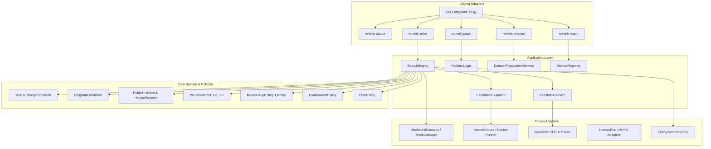
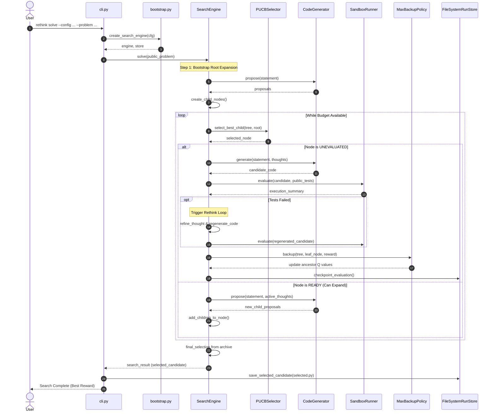
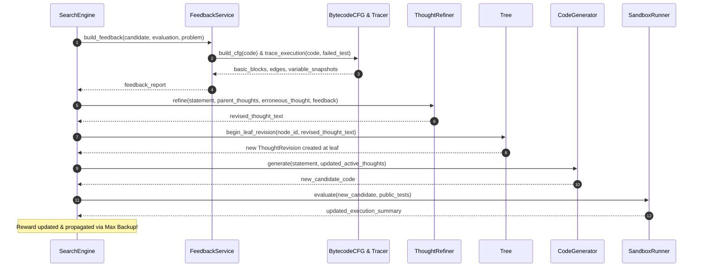

# RethinkMCTS Architecture & Developer Manual

Tài liệu hướng dẫn chi tiết về cấu trúc kiến trúc, nguyên lý thiết kế phần mềm, và quy trình tương tác nội bộ giữa các thành phần của hệ thống **RethinkMCTS**.

---

## 1. Triết lý Thiết kế: Ports & Adapters (Hexagonal Architecture)

Dự án tuân thủ nghiêm ngặt mô hình **Modular Monolith** kết hợp **Ports & Adapters (Kiến trúc Lục giác)** nhằm đạt được:
- **Tính độc lập cao:** Lõi thuật toán và các thực thể nghiệp vụ (`domain/`) hoàn toàn không phụ thuộc vào bất kỳ thư viện bên ngoài nào (không import HTTP client, không import Docker, không import Pydantic hay frameworks).
- **Dễ kiểm thử (Testability):** Có thể hoán đổi giữa mô hình thật (Ollama/vLLM) và `ScenarioMockLLM`, hoặc giữa trình chạy an toàn host (`TrustedFixtureExecutor`) và container (`DockerExecutor`) mà không làm thay đổi một dòng code thuật toán nào.
- **Tuân thủ nguyên lý SOLID:** Mọi mở rộng (dataset mới, reward policy mới, model gateway mới) đều được thực hiện thông qua việc triển khai một Adapter mới cho Port có sẵn, không sửa vòng lặp `SearchEngine`.



---

## 2. Chi tiết các Tầng Kiến trúc

### 2.1. Tầng Domain (`src/rethink_mcts/domain/`)
Chứa các đối tượng giá trị (Value Objects) và thực thể (Entities) bất biến:
- [`problem.py`](file:///Users/kotori/Documents/TLCN/src/rethink_mcts/domain/problem.py): 
  - `PublicProblem`: Chỉ chứa đề bài, giới hạn thời gian/bộ nhớ và các ca kiểm thử công khai (`public_tests`).
  - `HiddenProblem`: Chứa bộ kiểm thử ẩn (`hidden_suite`) độc lập hoàn toàn với `PublicProblem`.
  - `StdinCase`, `FunctionCase`, `AssertionSuite`: Ba dạng kiểm thử chuẩn hóa cho stdin, hàm gọi, và bộ assert.
- [`candidate.py`](file:///Users/kotori/Documents/TLCN/src/rethink_mcts/domain/candidate.py):
  - `ProgramCandidate`: Đối tượng bất biến đại diện cho một chương trình được mô hình sinh ra, kèm mã hash SHA-256 (`code_hash`), node xuất xứ (`node_id`), revision xuất xứ (`revision_id`) và snapshot chuỗi suy luận (`thought_path_snapshot`).
  - `ExecutionSummary`: Kết quả thực thi khách quan gồm số test đã chạy, số test pass/fail, tỷ lệ pass, và ca kiểm thử lỗi đầu tiên (`first_failed_case`).
- [`tree.py`](file:///Users/kotori/Documents/TLCN/src/rethink_mcts/domain/tree.py):
  - `SearchNode`: Node trong cây tìm kiếm, lưu trữ trạng thái duyệt (`READY`, `UNEVALUATED`, `EVALUATING`, `CLOSED`), độ sâu (`depth`), xác suất tiên nghiệm (`prior`) và danh sách con (`child_ids`).
  - `ThoughtRevision`: Lưu trữ nội dung suy luận tại mỗi phiên bản hiệu chỉnh, liên kết với node lá.
  - `Tree`: Đối tượng cây quản lý toàn bộ nodes và revisions, cung cấp hàm trích xuất chuỗi suy luận `get_active_thought_path(node_id)`.
- [`feedback.py`](file:///Users/kotori/Documents/TLCN/src/rethink_mcts/domain/feedback.py):
  - `CFGGraph`: Đồ thị các khối cơ bản (Basic Blocks) và cung chuyển tiếp (Branch Edges).
  - `TraceResult`: Chuỗi các lượt ghé thăm khối (`BlockVisit`) kèm snapshot trạng thái biến cục bộ.
  - `FeedbackReport`: Tổng hợp dữ liệu thực thi thực tế làm đầu vào cho LLM Refiner.
- [`budget.py`](file:///Users/kotori/Documents/TLCN/src/rethink_mcts/domain/budget.py):
  - `BudgetManager` & `Usage`: Quản lý chặt chẽ ngân sách tài nguyên (số lượt sinh code, số lượt gọi LLM, token, thời gian thực thi). Khi ngân sách chạm ngưỡng, hệ thống lập tức dừng tìm kiếm an toàn.

---

### 2.2. Tầng Thuật toán & Chính sách (`src/rethink_mcts/policies/`)
Triển khai thuần túy toán học và logic quyết định:
- [`selection.py`](file:///Users/kotori/Documents/TLCN/src/rethink_mcts/policies/selection.py): 
  Hiện thực chính xác công thức **P-UCB** (Eq. 1 & 2 của bài báo gốc). Duyệt từ Root xuống để chọn node con có điểm số cao nhất. Với node chưa từng được duyệt, $Q$ được gán bằng giá trị nhỏ nhất của các node anh em đã duyệt.
- [`backup.py`](file:///Users/kotori/Documents/TLCN/src/rethink_mcts/policies/backup.py):
  Hiện thực **Max Backup**: Khi một ứng viên có reward hợp lệ, giá trị reward được lan truyền ngược từ node lá lên root, cập nhật $Q(p) = \max(Q(p), R)$.
- [`reward.py`](file:///Users/kotori/Documents/TLCN/src/rethink_mcts/policies/reward.py):
  Hiện thực hàm thưởng kép **Dual Reward**: $R = 0.8 \cdot V_{\text{test}} + 0.2 \cdot V_{\text{llm}}$. Điểm Critic $V_{\text{llm}}$ chỉ được tính khi $V_{\text{test}} = 1.0$.
- [`prior.py`](file:///Users/kotori/Documents/TLCN/src/rethink_mcts/policies/prior.py):
  Chuẩn hóa điểm số tiên nghiệm (Reasonableness) của các thought do LLM đề xuất sao cho tổng bằng 1.0. Tự động phát hiện và gộp các thought trùng lặp ngữ nghĩa (Deduplication) để tránh phân mảnh nhánh tìm kiếm.
- [`final_selection.py`](file:///Users/kotori/Documents/TLCN/src/rethink_mcts/policies/final_selection.py):
  Chính sách lựa chọn ứng viên tốt nhất từ kho `CandidateArchive` để nộp cho Hidden Judge: Ưu tiên chương trình có Public Reward cao nhất, giải quyết hòa điểm bằng số test công khai vượt qua và thứ tự sinh sớm hơn.

---

### 2.3. Tầng Ứng dụng & Điều phối (`src/rethink_mcts/application/`)
- [`search.py`](file:///Users/kotori/Documents/TLCN/src/rethink_mcts/application/search.py) (`SearchEngine`):
  Trọng tâm điều phối toàn bộ vòng đời MCTS:
  1. Khởi tạo Root và bootstrap các thought ban đầu.
  2. Chọn node theo P-UCB.
  3. Mở rộng (Expansion) nếu node ở trạng thái `READY`.
  4. Sinh mã (Code Generation) nếu node ở trạng thái `UNEVALUATED`.
  5. Đánh giá mã nguồn trên Sandbox công khai.
  6. Kích hoạt **Rethink Loop** nếu chương trình thất bại trên public tests.
  7. Lan truyền Max Backup và chuyển trạng thái node thành `READY`.
  8. Lựa chọn ứng viên tối ưu cuối cùng và khóa kết quả.
- [`feedback.py`](file:///Users/kotori/Documents/TLCN/src/rethink_mcts/application/feedback.py) (`FeedbackService`):
  Điều phối việc phân tích Basic Blocks qua Bytecode CFG, chạy Dynamic Tracer để chụp ảnh trạng thái biến, và đóng gói thành phản hồi cấu trúc.
- [`judge.py`](file:///Users/kotori/Documents/TLCN/src/rethink_mcts/application/judge.py) (`HiddenJudge`):
  Tiến trình độc lập đọc file `selected.py` đã đóng băng và thực thi trên toàn bộ các ca kiểm thử của `HiddenProblem` để đưa ra tỷ lệ đỗ khách quan.
- [`prepare.py`](file:///Users/kotori/Documents/TLCN/src/rethink_mcts/application/prepare.py) (`DatasetPreparationService`):
  Bộ tiền xử lý dataset (HumanEval, APPS, CodeContests) tách bạch thành `public/problems.jsonl` và `judge/suites/*.json`.

---

### 2.4. Tầng Adapters (`src/rethink_mcts/adapters/`)
- **LLM (`adapters/llm/`):**
  - `HttpModelGateway`: Kết nối chuẩn OpenAI Chat Completions API (`/v1/chat/completions`), hỗ trợ Ollama, vLLM, Modal, OpenAI. Xử lý chuẩn hóa URL, giới hạn timeout, thử lại (retries) và tính toán token usage.
  - `ScenarioMockLLM`: Bộ giả lập kiểm thử theo kịch bản xác định, phục vụ chạy unit test và acceptance test không tốn GPU.
  - `SemanticPromptedLLM`: Nạp các Jinja2 templates và gọi gateway để đề xuất thought (`propose`), sinh code (`generate`), tự sửa thought (`refine`) và đánh giá (`assess`).
- **Thực thi Sandbox (`adapters/execution/`):**
  - `cfg.py`: Sử dụng module chuẩn của Python (`dis`) để phân tích mã byte (bytecode), tách mã nguồn thành các khối cơ bản (Basic Blocks) dựa trên các lệnh nhảy (`JUMP_FORWARD`, `POP_JUMP_IF_FALSE`, v.v.) và xây dựng các cung chuyển tiếp (Edges).
  - `tracing.py`: Sử dụng `sys.settrace` ở cấp độ dòng lệnh kết hợp frame identity (`id(frame)`), thực hiện chụp ảnh biến dạng sâu (`copy.deepcopy`) trước và sau khi thực thi khối, đảm bảo không bị lỗi dữ liệu bị biến đổi (mutation).
  - `trusted_fixture_executor.py`: Trình thực thi subprocess an toàn, kiểm tra cú pháp trước khi chạy (`compile`), giới hạn kích thước output và tự động hủy tiến trình quá thời gian (`SIGKILL`).
  - `docker_executor.py`: Trình thực thi trong Docker container cô lập không có đặc quyền root (non-root unprivileged), giới hạn bộ nhớ (`--memory`), CPU, và số lượng tiến trình con (`--pids-limit`).
- **Lưu trữ & Cache (`adapters/storage/`):**
  - `FileSystemRunStore`: Lưu trữ toàn bộ dấu vết thực nghiệm bằng cơ chế ghi file nguyên tử (`atomic write` qua file tạm `.tmp` rồi đổi tên `os.replace`), hỗ trợ lưu checkpoint sau mỗi giao dịch đánh giá để phục vụ khôi phục (`resume`) khi gặp sự cố.

---

## 3. Quy trình Vận hành Chi tiết (Sequence Diagrams)

### 3.1. Quy trình Tìm kiếm Lời giải (Solve Workflow)



---

### 3.2. Quy trình Rethink Tự Hiệu chỉnh (Rethink Lifecycle)



---

## 4. Hướng dẫn Mở rộng Hệ thống (Extensibility Guide)

### 4.1. Thêm một Mô hình / Nhà cung cấp LLM Mới
Hệ thống kết nối qua interface [`ModelGateway`](file:///Users/kotori/Documents/TLCN/src/rethink_mcts/ports/models.py):
1. Tạo class mới kế thừa `ModelGateway`:
   ```python
   from rethink_mcts.ports.models import ModelGateway, GenerationRequest, GenerationResponse

   class CustomAnthropicGateway(ModelGateway):
       def complete(self, request: GenerationRequest) -> GenerationResponse:
           # Triển khai gọi API Anthropic
           ...
           return GenerationResponse(content=text, prompt_tokens=p, completion_tokens=c)
   ```
2. Đăng ký gateway trong [`src/rethink_mcts/bootstrap.py`](file:///Users/kotori/Documents/TLCN/src/rethink_mcts/bootstrap.py) dựa trên cấu hình `cfg.model.transport`.

---

### 4.2. Thêm một Bộ Dữ liệu Benchmark Mới
1. Tạo adapter trong thư mục `src/rethink_mcts/adapters/datasets/`:
   ```python
   def parse_my_benchmark_record(item: dict) -> Tuple[PublicProblem, HiddenProblem]:
       # 1. Trích xuất public tests
       # 2. Trích xuất hidden tests
       return public_problem, hidden_problem
   ```
2. Thêm hàm nạp dữ liệu vào [`src/rethink_mcts/application/prepare.py`](file:///Users/kotori/Documents/TLCN/src/rethink_mcts/application/prepare.py) để hỗ trợ lệnh CLI `rethink prepare --dataset my_benchmark`.

---

### 4.3. Tùy biến Thuật toán Lựa chọn (Custom Selection Policy)
Mọi policy đều độc lập với engine:
1. Tạo class triển khai interface lựa chọn:
   ```python
   class CustomEpsilonGreedySelector:
       def select_best_child(self, tree: Tree, parent: SearchNode) -> Optional[SearchNode]:
           # Logic chọn node
           ...
   ```
2. Kết nối trong `bootstrap.py`.

---

## 5. Danh mục Kiểm thử & Tiêu chuẩn Nghiệm thu

Bộ kiểm thử được tổ chức theo 3 tầng kiểm chứng:
1. **Unit Tests (`tests/unit/`):**
   - `test_policies.py`: Kiểm chứng tính toán giải tích của P-UCB Eq. 1 & 2 (U01), gán giá trị khởi tạo sibling (U02), Max Backup so với Mean (U03), điều kiện kích hoạt Critic (U04–U08), chuẩn hóa prior (U09–U11), chính sách lựa chọn ứng viên cuối (U12–U13).
   - `test_parsers_and_gateway.py`: Kiểm thử parser trích xuất JSON proposals (U14), parser code blocks (U15), chuẩn hóa URL gateway (U16), bắt lỗi cấu hình không hợp lệ (U17).
   - `test_judge.py`: Kiểm thử tính toàn vẹn khi hidden suite rỗng (U18).
   - `test_humaneval_and_apps.py`: Kiểm thử adapter HumanEval trích xuất doctests và adapter APPS.
2. **Contract Tests (`tests/contracts/`):**
   - `test_cfg_and_trace.py`: Kiểm tra đồ thị basic block và edge từ bytecode (I15), tính bất biến của snapshot biến qua các vòng lặp/đệ quy (I16–I17), xử lý lỗi cú pháp (I18).
   - `test_rethink_and_tree.py`: Kiểm tra cơ chế leaf revision không làm đột biến cha (I04), Max Backup giữ giá trị cao nhất sau rethink (I05), từ chối rethink node nhánh (I06), chuỗi tổ tiên bất biến (I08), cắt ngân sách nghiêm ngặt (I10).
   - `test_datasets_and_leakage.py`: Kiểm thử đối kháng chống rò rỉ sentinel ẩn sang prompt/cache (I22), execution harness (I23), bắt lỗi lệch độ dài mảng test (I24).
3. **Acceptance Tests (`tests/acceptance/`):**
   - `test_scenario_a.py`: Kiểm thử luồng Watermelon provenance hoàn chỉnh (Solve -> Freeze -> Judge).
   - `test_scenario_b.py`: Kiểm thử giải pháp gian lận (hardcode public test) bị Hidden Judge đánh trượt 100%.
   - `test_scenario_c.py`: Hoán đổi endpoint cấu hình mà không sửa đổi mã nguồn.
   - `test_scenario_d.py`: Ngắt ngân sách an toàn và khôi phục từ checkpoint.
