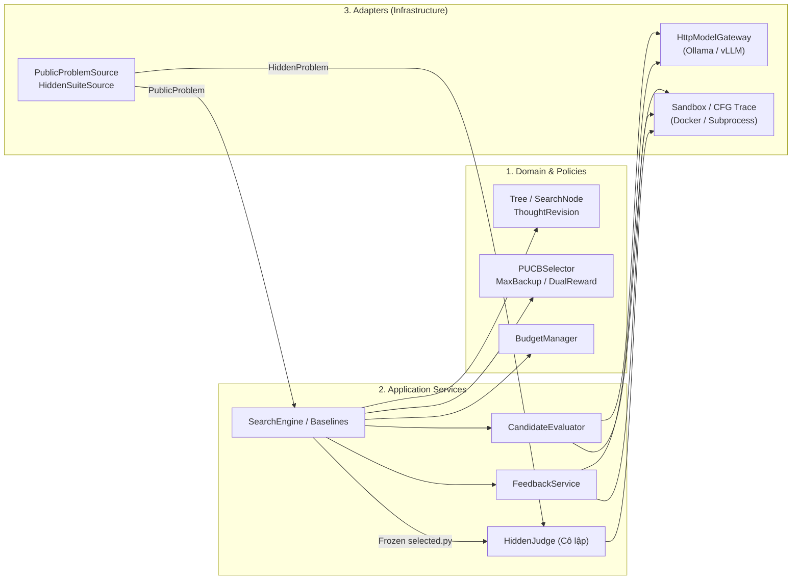

# Chương 2. Giải pháp: Khung thuật toán RethinkMCTS cho Mô hình Nhỏ

> Tham chiếu: *RethinkMCTS* (arXiv:2409.09584v2, Mục 3–4 & Appendix C–D), [Proposal.md](../../Proposal.md) (4 trụ cột kỹ thuật), [rethinkmcts_small_model_spec.md](../rethinkmcts_small_model_spec.md) và [architecture.md](../architecture.md).

## 2.1. Bốn Trụ cột Kỹ thuật của Hệ thống

1. **Trụ cột 1 — Tìm kiếm MCTS ở mức Tư duy (Thought-Level Search) & Lựa chọn P-UCB:**
   Mỗi nút trên cây biểu diễn một bước ý tưởng thuật toán $a$, trạng thái $s$ là đề bài cộng chuỗi tư duy từ gốc tới nút hiện tại.
2. **Trụ cột 2 — Sandbox Thực thi làm "World Model Chân lý" & Phân tích Khối lệnh (Block-Level CFG Trace):**
   Khác với RAP dùng prompt để đoán kết quả, hệ thống thực thi code thật trên `public_tests` trong Sandbox cô lập. Khi thất bại, bộ thu thập trace phân rã chương trình thành các khối cơ bản (Basic Blocks trên CFG), ghi lại giá trị biến trước/sau mỗi khối và tạo phản hồi ngôn ngữ (`verbal feedback`).
3. **Trụ cột 3 — Hiệu chỉnh Tư duy tại Lá (Leaf Revision / Rethink) & Lan truyền Max Backup:**
   Khi ứng viên mã thất bại kiểm thử công khai, hệ thống dùng `verbal feedback` để sinh lại tư duy tại đúng nút lá hiện tại $z_{\text{new}} \sim p(z \mid s, f, z_{\text{old}})$ mà **không sửa các nút tổ tiên** (bảo toàn lịch sử phần thưởng và chuỗi tư duy đúng phía trên).
4. **Trụ cột 4 — Quản lý Ngân sách, Dừng sớm & Đánh giá Kép Có điều kiện (Conditional Dual Evaluation):**
   Chỉ gọi LLM Critic khi ứng viên vượt qua 100% `public_tests` ($v_{test} = 1.0$) và dừng sớm khi đạt điều kiện.

## 2.2. Công thức Toán học & Vòng lặp Thuật toán (Algorithm 1)

### (a) Lựa chọn nhánh với P-UCB (Paper Eq. 1 & 2 — `policies/selection.py`)

Tại trạng thái $s$, thuật toán chọn hành động (thought con) $a$ cực đại hóa:

$$\text{P-UCB}(s, a) = Q(s, a) + \beta(s) \cdot P(a \mid s) \cdot \frac{\sqrt{\ln N(s)}}{1 + N(s')}$$

trong đó $s'$ là nút con đạt được khi thực hiện $a$ từ $s$, $P(a \mid s)$ là điểm hợp lý tiên nghiệm (prior reasonableness) đã chuẩn hóa, và hệ số khám phá:

$$\beta(s) = \ln\left(\frac{N(s) + c_{\text{base}} + 1}{c_{\text{base}}}\right) + c, \quad (c_{\text{base}} = 10.0,\; c = 4.0)$$

### (b) Mở rộng (Expansion) có xét Phản hồi (Paper §4)
- **Khi nút lá chưa có lỗi hoặc pass hết public tests:** Sinh tối đa $k=3$ bước tư duy con kèm điểm tiên nghiệm: $[(z_1, e_1), \dots, (z_k, e_k)] \sim p((z, e) \mid s)$.
- **Khi nút lá có test công khai thất bại:** Đưa phản hồi thực thi $f$ vào prompt mở rộng: $[(z_1, e_1), \dots, (z_k, e_k)] \sim p((z, e) \mid s, f)$.

### (c) Hàm thưởng Kép Có điều kiện (Paper Eq. 3 — [reward.py](../../src/rethink_mcts/policies/reward.py))

$$R = \begin{cases} v_{\text{test}} & \text{nếu } v_{\text{test}} < 1.0 \\ a \cdot v_{\text{test}} + b \cdot v_{\text{llm}} & \text{nếu } v_{\text{test}} = 1.0 \end{cases}$$

- $v_{\text{test}} = \frac{\text{passed\_public}}{\text{total\_public}} \in [0, 1]$.
- Cấu hình **Dual Reward**: $(a, b) = (0.8, 0.2)$. Điểm $0.8 + 0.2 \cdot v_{\text{llm}}$ cho phép hạ điểm những code tuy pass ít public tests nhưng bị Critic phát hiện lỗi logic hoặc thiếu điều kiện biên (Paper §6, Table 3).
- Cấu hình **Test-only (Ablation)**: $(a, b) = (1.0, 0.0)$ — không gọi LLM Critic.

### (d) Lan truyền ngược (Backpropagation)
Cập nhật dọc đường đi từ nút hiện tại về gốc theo chính sách **Max Backup** ($Q(s, a) = \max R$), kèm hỗ trợ cấu hình **Mean Backup** (`search.backup=mean`) để làm thực nghiệm đối chứng (Ablation).

## 2.3. Các Chế độ Phản hồi Thực thi (Feedback Modes)

Hệ thống hỗ trợ 5 chế độ trong `feedback.mode` ([config.py](../../src/rethink_mcts/config.py#L76)) phục vụ nghiên cứu triệt tiêu:
1. `none`: Không đưa nội dung phản hồi lỗi vào prompt rethink (Ablation `w/o VF` trong Paper Figure 3).
2. `facts_only`: Chỉ cung cấp thông tin kiểm thử thất bại cơ bản (input, expected, actual, loại lỗi CE/RE/TLE/WA).
3. `trace`: Bổ sung vết thực thi dòng/biến runtime nhưng không gọi LLM phân tích block (Ablation `w/o blockInfo` trong Paper Figure 3).
4. `block`: Phân tách CFG thành basic blocks, thu thập biến trước/sau mỗi block và gọi LLM `analyze_block` để chẩn đoán nguyên nhân lỗi (Phương pháp đầy đủ của RethinkMCTS).
5. `adaptive`: Bộ điều khiển tự động nâng mức phản hồi (`facts_only` $\to$ `trace` $\to$ `block`) khi qua `escalate_after` lượt không cải thiện `pass_rate` ([PROTOCOL.md §2](../research/PROTOCOL.md)).

## 2.4. Kiến trúc Phần mềm (Ports & Adapters) & Chống Rò rỉ Kiểm thử

- **Cô lập kiểm thử ẩn (Zero Test Leakage):** `SearchEngine` chỉ nhận đối tượng `PublicProblem`. Tập `HiddenProblem` chỉ được nạp vào `HiddenJudge` ([judge.py](../../src/rethink_mcts/application/judge.py)) sau khi quá trình tìm kiếm đã kết thúc và đóng băng `selected.py` (được kiểm chứng tự động qua `tests/contracts/test_datasets_and_leakage.py`).

## 2.5. Bảng Đối chiếu Giữa Bài báo Gốc và Bản Hiện thực trên Mô hình Nhỏ

| Hạng mục | Bài báo gốc (Li et al., EMNLP 2025) | Bản hiện thực của Đề tài (`rethink_mcts`) | Lý do điều chỉnh |
| :--- | :--- | :--- | :--- |
| **Mô hình nền** | GPT-3.5-turbo, GPT-4o-mini (Proprietary API) | Qwen2.5-Coder 7B & 14B Instruct (Open-weight) | Tự chủ hạ tầng, tối ưu cho phân khúc $\le$ 14B |
| **Prompt Templates** | Prompt đầy đủ nhiều ví dụ (Appendix C, Table 8–12) | Hỗ trợ cả `compact_v1` và `native_v2` ([prompts/](../../prompts/)) | Giảm độ dài ngữ cảnh đầu vào cho cửa sổ 16K của SLM |
| **Giới hạn Trace** | Toàn bộ các block và biến trong trace | Giới hạn `max_trace_visits=256`, `max_prompt_blocks=32`, `max_feedback_tokens=2048` | Tránh tràn context window khi gặp vòng lặp lớn |
| **Nhiệt độ sinh (Sampling)** | $T = 0$ cố định (Paper Appendix B) | Phân tách theo vai trò: `expansion=0.6`, `code=0.2`, `rethink=0.3`, `critic=0.0` | Tăng tính đa dạng khi sinh nhánh tư duy và sửa lỗi |
| **Quản lý Ngân sách** | Giới hạn cố định 16 rollouts | `BudgetManager` đa chiều (calls, code attempts, tokens, wall-time) + Early Stopping | Kiểm soát chi phí thực tế khi chạy vLLM / Ollama |

> **TODO cho khi viết toàn văn Chương 2:**
> - [ ] Đưa mã giả **Algorithm 1** (bản đầy đủ có `BudgetManager` và `EarlyStop`) vào mục 2.2.
> - [ ] Đưa bảng tóm tắt 5 mẫu prompt (`expand`, `generate_code`, `analyze_block`, `rethink`, `self_eval`) vào Phụ lục hoặc mục 2.3.
> - [ ] Đưa 1 ví dụ minh họa thực tế từ `runs/benchmark_apps_14b_dual_unified` (tương tự Table 13 & 14 của bài báo: chuỗi Thought $\to$ Code lỗi $\to$ Block Feedback $\to$ Rethink Thought $\to$ Code đúng).
