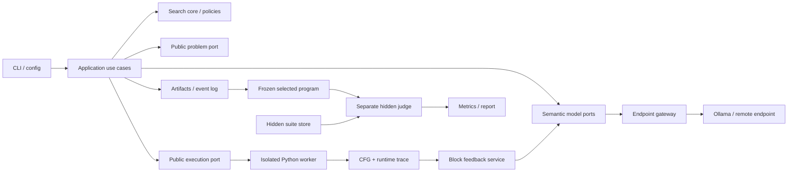

# Đặc tả triển khai RethinkMCTS cho mô hình 7B–14B

> Phiên bản: 1.0 — 2026-09-05. Tài liệu bàn giao cho AI lập trình.
>
> Mục tiêu: triển khai đầy đủ cơ chế RethinkMCTS, có cấu hình thích hợp cho mô hình nhỏ, kiến trúc dễ kiểm thử và thay thế thành phần. Đây là đặc tả cần triển khai, không phải mô tả các tính năng đã có trong repository.

Đọc theo thứ tự nếu triển khai mới. Khi tra cứu nhanh: phạm vi và nguồn ở §1–2; kiến trúc/contracts ở §3–5; thuật toán ở §6–7; feedback/endpoint/sandbox ở §8–10; dataset/config/artifacts/CLI ở §11–14; thực nghiệm ở §15–17; tests/migration/milestones/checklist ở §18–21. **§22 có prompt giao việc có thể sao chép cho AI lập trình.**

## 1. Quyết định đã chốt và phạm vi

### 1.1. Yêu cầu của chủ dự án

- Test trên máy bằng **Ollama + Qwen2.5-Coder-7B-Instruct**.
- Khi deploy, dùng mô hình phân khúc khoảng **14B**; chưa chốt checkpoint cụ thể.
- Cho phép nhập **URL endpoint**, tên model và thông tin xác thực qua cấu hình/CLI. Đổi nơi chạy model không được đòi sửa thuật toán.
- Triển khai lại paper, ưu tiên cấu trúc clean, SOLID, dễ bảo trì, có thể giao cho AI khác code theo từng phần.
- Ngôn ngữ lời giải: Python. Ngôn ngữ tài liệu: tiếng Việt; identifier và prompt gửi model mặc định tiếng Anh.

`Qwen2.5-Coder-14B-Instruct` chỉ là lựa chọn cấu hình dự kiến cùng họ, không phải yêu cầu khóa cứng. Không mặc định người dùng có CUDA, GPU 24 GB, hoặc ngân sách cloud cụ thể. Máy điều phối tìm kiếm chỉ cần kết nối endpoint và runtime thực thi code; không bắt buộc tải trọng số model.

### 1.2. Những gì phải làm

1. Thought-level MCTS: selection, expansion, code generation, public evaluation, backpropagation.
2. Prior do LLM chấm cho các thought; P-UCB; Q dùng **max reward**.
3. Dual evaluation: public tests và LLM self-evaluation.
4. Feedback từ thực thi thật, bao gồm CFG/basic blocks, trạng thái biến và LLM phân tích block.
5. Rethink thay thought hiện tại dựa trên feedback, sinh lại code và đánh giá lại.
6. Model gateway qua endpoint, structured output, retry có giới hạn, token/call/time budget.
7. Dataset adapters, tách public/hidden, chọn một lời giải cuối rồi mới chấm hidden.
8. CLI, lưu artifacts, resume, metrics, baselines, ablations và báo cáo thực nghiệm.
9. Hai cấu hình rõ ràng: bám cơ chế paper và điều chỉnh cho mô hình nhỏ.

### 1.3. Không nhập nhằng với đề cương rộng hơn

`Proposal.md` có Journey SFT, GRPO, RLVR và hybrid inference. **Các phần huấn luyện này không thuộc thuật toán RethinkMCTS của paper**. V1 phải chạy với trọng số model cố định. Chỉ thiết kế export trajectories để nghiên cứu huấn luyện sau này; không thêm TRL, optimizer, trainer vào core.

Không đặt tiêu chí nghiệm thu rằng model nhỏ phải đạt số liệu GPT trong paper, giảm 70% rollouts, hoặc chắc chắn tốt hơn baseline. Đó là giả thuyết cần đo. Public tests chỉ kiểm chứng hành vi trên các test đã chạy; không chứng minh chương trình đúng cho mọi input.

### 1.4. Ba mức hoàn thành

| Mức | Điều kiện |
|---|---|
| `core_complete` | Đủ thuật toán, dual evaluation, block analysis, rethink, endpoint thật, sandbox và các kiểm thử hợp đồng |
| `small_model_ready` | Core hoàn chỉnh + preset 7B/14B, CodeContests, budgets, baselines tối thiểu, ablations và báo cáo chi phí |
| `paper_experiment_suite_complete` | Thêm APPS/HumanEval, toàn bộ nhóm baseline và các nghiên cứu phụ ở §17; không chỉ demo Watermelon |

Hoàn thành MVP không đồng nghĩa đã implement toàn bộ paper. Thứ tự triển khai có thể tăng dần, nhưng các mục bắt buộc trong ba mức trên không được bỏ bằng cách gọi chúng là TODO.

## 2. Nguồn tham chiếu và quy tắc bám paper

### 2.1. Paper được dùng

Nguồn chính là [Rethink.pdf](../Rethink.pdf), **RethinkMCTS: Refining Erroneous Thoughts in Monte Carlo Tree Search for Code Generation**, arXiv **2409.09584v2**, ngày ghi trong PDF **24 Oct 2025**, 19 trang.

SHA-256 của file đã đọc:

```text
37a1f77a0157afad7a7a8c07d81b5f37c609edaa414625f89936a07abfcaa168
```

Các vị trí cần đối chiếu:

| Nội dung | Vị trí trong PDF |
|---|---|
| Public/private và bài toán code generation | §3.1, trang 3 |
| CFG, basic blocks, biến trước/sau | §3.2, trang 3 |
| Cây thought và overview | Figure 2, trang 4 |
| P-UCB, beta, Q=max, prior | §4, Eq. 1–2, trang 4 |
| Reward phân nhánh và rethink leaf | §4, Eq. 3, trang 5 |
| APPS/HumanEval, tham số, metric | §5–6, trang 6 |
| Ablation, granularity, reflection/rethink | trang 7 |
| Compute scaling và reward weights | trang 7–8 |
| Hạn chế, fine-tuning chưa nghiên cứu | trang 9 |
| Token cost, generated tests, nhiều seed | Appendix B, trang 12–14 |
| Expansion, code, self-eval, rethink prompts | Appendix C, Tables 8–12, trang 14–16 |
| Thought trajectory và block feedback | Tables 13–14, trang 17–18 |
| Pseudocode | Appendix D, Algorithm 1, trang 19 |

Repo tác giả: [SIMONLQY/RethinkMCTS](https://github.com/SIMONLQY/RethinkMCTS). Có thể tham khảo [implementation](https://github.com/SIMONLQY/RethinkMCTS/blob/master/models/RethinkMCTS.py) và [tham số chạy](https://github.com/SIMONLQY/RethinkMCTS/blob/master/run.py). Khi dùng code upstream để đối chiếu, phải lưu commit SHA. Tài liệu này không tuyên bố đã kiểm chứng toàn bộ hành vi repo tác giả hoặc tái lập số liệu của họ.

### 2.2. Nhãn nguồn của quyết định

- **PAPER**: có mô tả trực tiếp trong PDF.
- **RESOLUTION**: quyết định triển khai nhằm giải quyết chỗ paper thiếu hoặc không nhất quán.
- **ADAPTATION**: thay đổi có chủ đích cho mô hình nhỏ/hạ tầng của dự án.
- **EXTENSION**: nghiên cứu thêm, không được gắn nhãn đóng góp nguyên bản của paper.

`run_manifest.json` phải ghi `algorithm_spec_version`, `profile`, `deviations[]` và hash cấu hình. Không đặt tên profile là `exact_reproduction` khi còn các RESOLUTION/ADAPTATION.

### 2.3. Những chỗ phải xử lý rõ, không chép pseudocode máy móc

| Vấn đề | Quyết định bắt buộc |
|---|---|
| §4 định nghĩa Q=max; MVP hiện dùng trung bình | Dùng max backup. Mean chỉ xuất hiện trong ablation riêng |
| Algorithm 1 mở rộng children rồi `GENERATE(node)`, còn prose nói rethink leaf | Dùng lifecycle evaluate/rethink trước khi node trở thành parent; root chỉ bootstrap expansion. Ghi RESOLUTION |
| Algorithm 1 gọi LLM eval trước điều kiện, prose/Eq. 3 chỉ cần khi public pass hết | Chỉ gọi self-eval khi `total > 0` và `passed == total` |
| Algorithm 1 không mô tả đầy đủ backup sau rethink | Mỗi evaluation có reward hợp lệ đều được backup đúng một lần |
| Algorithm 1 chưa định nghĩa bộ đếm code sinh lại | Code generation trong rethink cũng tiêu thụ budget; ghi riêng outer iterations và code attempts |
| Table 11 yêu cầu self-eval trong **[-1, 1]** | Profile bám paper giữ miền này; profile nhỏ dùng [0, 1] và ghi ADAPTATION |
| Table 8 yêu cầu reasonableness trong [0, 1], tổng bằng 1 | Lưu raw scores, validate và chuẩn hóa; không gọi đây là token log-probability |
| Paper chưa đủ chi tiết về đổi thought và thống kê cũ | Dùng revision cho leaf, theo quy tắc §7.5; không sửa ngầm nội dung node vẫn còn descendants |
| Một số ví dụ LLM block analysis có thể sai | Execution facts và model interpretation là hai trường riêng; nhận xét của LLM không phải ground truth |

**Lưu ý reward:** Với Table 11 và `(a,b)=(0.8,0.2)`, code pass public có reward từ **0.6 đến 1.0**. Không tự đổi miền [-1,1] sang [0,1] trong profile bám paper. Chỉ dùng ánh xạ `(x+1)/2` nếu có một profile ADAPTATION riêng ghi rõ.

## 3. Kiến trúc tổng thể

### 3.1. Kiểu kiến trúc

Dùng **modular monolith + ports/adapters**. Một process điều phối, một endpoint model và worker sandbox. Không cần microservices, message broker, framework đa agent, vector database hay dependency injection container.



Luồng phụ thuộc source code:

```text
domain <- ports <- application
domain/ports <- adapters
application + adapters <- bootstrap / cli
```

`domain` không import HTTP client, Ollama, SDK model, Docker, datasets hoặc Pydantic. `application` không import concrete adapters. `bootstrap.py` là nơi duy nhất chọn implementation từ config và nối chúng lại.

### 3.2. SOLID áp dụng vào bài toán cụ thể

| Nguyên tắc | Yêu cầu thực tế |
|---|---|
| S — một trách nhiệm | Node giữ trạng thái; selector tính score; evaluator điều phối chấm; executor chỉ chạy; analyzer diễn giải feedback |
| O — mở rộng | Thêm reward/prior/model/dataset bằng implementation mới của port, không sửa vòng lặp engine |
| L — thay thế được | Mock, Ollama và remote gateway trả cùng DTO/error semantics; adapter không hỗ trợ tính năng phải báo capability |
| I — interface nhỏ | Tách `ThoughtProposer`, `CodeGenerator`, `ThoughtRefiner`, `CodeCritic`, `BlockAnalyzer`; baseline direct chỉ cần generator |
| D — đảo ngược phụ thuộc | Engine nhận ports/policies qua constructor; không tự đọc env, tạo HTTP session hoặc khởi động Docker |

Không tạo interface cho mọi helper hoặc class chỉ để bọc một hàm thuần. Dùng `typing.Protocol` ở ranh giới thay thế thật; domain dùng dataclass/enum và các hàm thuần.

### 3.3. Cấu trúc thư mục đích

```text
src/rethink_mcts/
  domain/
    problem.py           # PublicProblem, TestCase, execution mode
    tree.py              # Node, ThoughtRevision, Tree, trạng thái
    candidate.py         # ProgramCandidate, EvaluationRecord
    feedback.py          # ExecutionFacts, BlockTrace, VerbalFeedback
    budget.py            # BudgetLimits, Usage, reservations
    events.py            # Event envelope và payload types
    errors.py            # Typed domain/application errors
  ports/
    models.py            # 5 semantic model ports và raw ModelGateway
    execution.py         # PublicExecutor, TraceCollector
    datasets.py          # PublicProblemSource, HiddenSuiteSource
    storage.py           # RunStore, EvaluationCache
  application/
    search.py            # SearchEngine orchestration
    evaluate.py          # CandidateEvaluator, conditional self-eval
    feedback.py          # Trace + BlockAnalyzer + ContextBuilder
    rethink.py           # Leaf refinement lifecycle
    solve.py             # SolveProblem use case
    benchmark.py         # Search batch; không truy cập hidden
    judge.py             # Chấm selected program đã khóa
    export.py            # Report, trajectories
  policies/
    selection.py         # PUCBSelector
    prior.py             # Raw LLM normalization, uniform ablation
    backup.py            # MaxBackup, mean ablation
    reward.py            # PaperDualReward, TestOnlyReward
    stopping.py          # Budget/depth/exhaustion/optional early stop
    final_selection.py   # Reward argmax, optional public-first
  adapters/
    llm/
      http_gateway.py    # OpenAI-compatible endpoint transport
      semantic.py        # Prompt/render/parse -> semantic ports
      mock.py            # Scenario mock, không global rethink flag
      parsing.py         # JSON/code/score validation
      capabilities.py    # context, schema, seed, usage capabilities
    execution/
      docker_executor.py
      trusted_fixture_executor.py
      worker.py          # Chạy trong sandbox, không import credentials
      harnesses.py       # stdin, function/class, assertion suite
      comparators.py
      cfg.py             # Static CFG theo runtime Python đã pin
      tracing.py         # Dynamic block visits, bounded snapshots
    datasets/
      code_contests.py
      apps.py
      humaneval.py
      jsonl.py
    storage/
      filesystem.py
      cache.py
  config.py              # Pydantic cho cấu hình, strict validation
  bootstrap.py
  cli.py
prompts/
  paper_v1/              # Semantic content của Appendix C
  compact_v1/            # Prompt ngắn/JSON nhất quán cho 7B–14B
configs/
  paper_reference.yaml
  ollama_7b.yaml
  remote_14b.yaml
  smoke_mock.yaml
  experiments/           # Baselines, ablations, sweep definitions
deploy/
  sandbox/Dockerfile
  model/README.md         # Server deployment tách khỏi search package
tests/
  unit/
  contracts/
  integration/
  acceptance/
  fixtures/
docs/
  rethinkmcts_small_model_spec.md
  decisions/             # ADR khi implementation cần khác spec
pyproject.toml
```

Đây là ranh giới trách nhiệm, không yêu cầu tạo toàn bộ file rỗng từ đầu. Gộp helper nhỏ khi hợp lý nhưng phải giữ dependency direction.

## 4. Data contracts và invariants

### 4.1. Problem và test visibility

```python
@dataclass(frozen=True)
class PublicProblem:
    problem_id: str
    statement: str
    execution_spec: ExecutionSpec
    public_tests: tuple[TestCase, ...]
    limits: ProblemLimits
    metadata: PublicMetadata

@dataclass(frozen=True)
class HiddenProblem:
    problem_id: str
    hidden_suite: HiddenSuite
    judge_spec: JudgeSpec
```

`PublicProblem` **không có** private/generated tests, reference solution, incorrect solution, hidden-suite đường dẫn hay callback đọc hidden. Đừng truyền schema raw của dataset vào model hoặc search.

`PublicMetadata` chỉ chứa field được allowlist: source, split, difficulty phục vụ báo cáo, runtime constraints. Tags thuật toán và editorial-derived metadata không tự động đưa vào prompt. `problem_id` phải ổn định theo dataset revision + source ID, không dùng title đơn lẻ làm khóa duy nhất.

`TestCase` là tagged union:

- `StdinCase(stdin: str, expected_stdout: str, comparator_id: str)`.
- `FunctionCase(args: JSONValue[], kwargs: dict, expected: JSONValue, comparator_id)`.
- `AssertionSuite` cho benchmark có harness Python chính thức; chỉ chạy bên trong sandbox.

`ExecutionSpec`: `mode = stdin | function | class_method | assertion_suite`, entry point, signature/starter code nếu có. Không ép mọi dataset về `input()/print()`.

### 4.2. Tree, node và thought

| Kiểu | Trường cần có |
|---|---|
| `ThoughtProposal` | text, raw_reasonableness, normalized_prior, generation_record_id |
| `ThoughtRevision` | revision_id, text, parent_revision_path_hash, replaces_revision_id, feedback_id, created_at |
| `SearchNode` | node_id, parent_id, depth, active_revision_id, prior, child_ids, status, visits, q_max, latest_evaluation_id, expansion_attempts, rethink_count |
| `Tree` | root_id, nodes mapping, revision registry |

Root depth=0, thought rỗng, không rethink root. `node_id` là vị trí logic; `revision_id` định danh nội dung thật. Lời giải, reward và feedback phải tham chiếu revision đã sinh ra chúng.

Node trạng thái: `UNEVALUATED -> EVALUATING -> READY -> EXPANDED`; hoặc `CLOSED`. `READY` nghĩa là đã kết thúc các rethink cục bộ và được phép mở rộng. `CLOSED` luôn có reason: depth limit, no valid proposals, context limit, generation failures hoặc exhausted. Trạng thái `EVALUATING` chưa commit không được khôi phục thành kết quả đã hoàn tất.

### 4.3. Candidate và evaluation tách khỏi node

`ProgramCandidate` bất biến:

```text
candidate_id, problem_id, code, code_hash, language,
node_id, revision_id, thought_path_snapshot,
origin = initial | rethink | baseline,
generation_record_id, created_sequence
```

`EvaluationRecord` bất biến:

```text
evaluation_id, candidate_id, suite_visibility=public,
suite_hash, harness_hash, execution_summary,
v_test: float | null, self_eval_raw: float | null,
self_eval_status, reward: float | null, reward_policy_id,
feedback_id, code_cache_hit, backup_committed
```

Không dùng `dict[code] = reward` làm nguồn dữ liệu duy nhất: cùng code có thể đến từ nhiều thought, nhiều lần self-eval hoặc suite khác nhau. Cache thực thi theo code hash; provenance theo candidate/evaluation ID.

### 4.4. Execution result

Phân biệt:

- Candidate verdict: `AC`, `WA`, `CE`, `RE`, `TLE`, `MLE`, `OLE`.
- Hạ tầng: `INFRA_ERROR`, `CANCELLED`, `INCOMPLETE`.
- Suite rỗng: `NO_TESTS`; không có pass rate hợp lệ.

`ExecutionSummary`: total, executed, passed, failed, pass_rate nullable, all_passed, result refs, elapsed, resource usage nếu đo được.

Invariants:

1. `all_passed = total > 0 and executed == total and passed == total`.
2. `v_test = passed / total` chỉ khi suite hợp lệ và đã chấm đầy đủ hoặc verdict xác định toàn bộ (ví dụ CE trước chạy).
3. Không chấm vài public tests rồi lấy mẫu số là số test đã chạy để tăng reward.
4. Khi hết budget giữa suite: đánh dấu incomplete; không tạo reward giả từ dữ liệu thiếu.
5. `INFRA_ERROR` không được chuyển thành lỗi logic của model. Policy retry hạ tầng có giới hạn; báo riêng ảnh hưởng benchmark.

### 4.5. Model I/O và usage

`GenerationRequest`: request_id, role, messages, sampling, max_output_tokens, response_contract, seed optional, deadline.

`GenerationResponse`: content, finish_reason, provider_request_id, model_id thực tế nếu có, prompt_tokens/completion_tokens nullable, elapsed, raw_response_ref đã bỏ secrets.

`Usage`: model_calls theo role, transport_attempts, code_generation_attempts, valid_candidates, evaluation_events, unique_programs, sandbox_runs, trace_runs, input/output tokens, token_estimation_method, cache_hits, wall_time.

Chỉ model output có cấu trúc phục vụ thuật toán mới được lưu; không phụ thuộc endpoint cung cấp trường suy luận nội bộ đặc thù của một model.

## 5. Ports và trách nhiệm orchestration

Các chữ ký dưới đây là hợp đồng định hướng; implementation phải bổ sung kiểu đầy đủ, không để `Any` lan vào core.

```python
class ThoughtProposer(Protocol):
    def propose(self, context: ThoughtContext, width: int,
                feedback: VerbalFeedback | None) -> ProposalBatch: ...

class CodeGenerator(Protocol):
    def generate(self, context: CodeContext) -> GeneratedProgram: ...

class ThoughtRefiner(Protocol):
    def refine(self, context: RethinkContext) -> RefinedThought: ...

class CodeCritic(Protocol):
    def assess(self, context: CriticContext) -> SelfAssessment: ...

class BlockAnalyzer(Protocol):
    def analyze(self, facts: BlockAnalysisContext) -> BlockAnalysis: ...

class PublicExecutor(Protocol):
    def evaluate(self, candidate: ProgramCandidate,
                 tests: tuple[TestCase, ...],
                 spec: ExecutionSpec, limits: ExecutionLimits
                 ) -> ExecutionSummary: ...

class TraceCollector(Protocol):
    def collect(self, candidate: ProgramCandidate,
                failed_case: TestCase, spec: ExecutionSpec,
                limits: TraceLimits) -> TraceResult: ...

class SearchAlgorithm(Protocol):
    def solve(self, problem: PublicProblem,
              context: RunContext) -> SearchResult: ...
```

Semantic ports có thể cùng dùng một `PromptedModel` implementation và một gateway. Không cần năm model servers. Cho phép override model cho critic/analyzer trong tương lai, nhưng mặc định **mọi role dùng cùng checkpoint** để kiểm soát chi phí và tránh thay đổi thực nghiệm không được ghi nhận.

`SearchEngine` chỉ giữ orchestration: chọn node, yêu cầu sinh/evaluate/rethink, commit events, backup và stop. Nó không parse JSON, ghép prompt, tính output diff, tải dataset hoặc chấm hidden.

Chạy tuần tự trong một cây ở v1. Có thể chạy nhiều problem độc lập bằng worker pool sau khi core đúng; không triển khai concurrent MCTS/virtual loss ở bản đầu.

## 6. MCTS: định nghĩa toán học

### 6.1. State và action

`s = (statement, public task contract, thoughts từ root đến parent)`.

`a = một thought mới`, là bước lập kế hoạch/chiến lược bằng ngôn ngữ tự nhiên. Node con chứa state sau khi nối thought. Mỗi lần evaluate sinh **chương trình hoàn chỉnh** từ prefix thoughts, không sinh một đoạn code nhỏ làm state mặc định.

Các sibling là **những lựa chọn thay thế cho bước kế tiếp**, không phải danh sách các bước bắt buộc phải làm nối tiếp nhau. Prompt không được yêu cầu một list rồi engine nối toàn bộ sibling thành cùng một path.

### 6.2. Prior

Model trả `{thought, reasonableness}` cho tối đa k proposals. Với raw scores hợp lệ `e_i >= 0`:

```text
P_i = e_i / sum_j(e_j)
```

Loại thought rỗng, deduplicate bằng normalized text trong cùng batch, cộng raw score của duplicate rồi normalize. Lưu batch gốc và transformed batch. Không dùng embedding dedup trong v1.

Nếu tổng=0 hoặc toàn bộ scores không hợp lệ: retry cấu trúc tối đa một lần; nếu vẫn lỗi, profile nhỏ có thể dùng uniform trên các thought hợp lệ và ghi `prior_fallback=uniform`. Profile reference dừng operation với typed error. Không âm thầm dùng prior uniform cho mọi request.

### 6.3. Selection — PAPER, Eq. 1–2

```text
beta(s) = ln((N(s) + c_base + 1) / c_base) + c

P_UCB(s,a) = Q(s,a)
             + beta(s) * P(a|s) * sqrt(ln(N(s))) / (1 + N(s'))
```

Mặc định `c_base=10`, `c=4`. Dùng natural logarithm. **Không đổi `sqrt(log(N))` thành `sqrt(N)`** như PUCT khác.

RESOLUTION cho bootstrap/tie:

1. Trong các children chưa evaluate và còn hợp lệ, ưu tiên prior cao nhất, sau đó creation order. Không tính `log(0)`.
2. Khi tất cả children đã evaluate, parent phải có visits>=1; dùng đúng công thức trên.
3. Score hòa: prior cao hơn, rồi creation order. Không phụ thuộc iteration order của set.
4. Bỏ qua subtree đã exhausted; không quay vô hạn vào node closed.

Khởi tạo `Q=0`, `N=0`; với reward modes ở tài liệu này mọi reward hợp lệ không âm. Guard bootstrap là RESOLUTION, phải có test, không thêm epsilon bí mật vào công thức.

### 6.4. Reward — PAPER, Eq. 3

```text
v_test = public_passed / public_total

reward = v_test                       nếu v_test < 1
reward = a*v_test + b*v_llm            nếu v_test = 1
```

Reference: `a=0.8`, `b=0.2`, `v_llm ∈ [-1,1]` theo Table 11.

Compact: cùng a,b nhưng critic contract `v_llm ∈ [0,1]`; ghi ADAPTATION. Không chia một score bất kỳ cho 10/100 để đoán thang điểm.

Không clamp reward về [0,1] khi chạy sweep `(a,b)=(1,0.2)` hoặc `(1,1)`. Giới hạn hợp lệ được suy ra từ config, không hardcode trong node.

Nếu bỏ self-eval: `reward=v_test` cho mọi candidate. Khi public suite rỗng: mặc định exclude problem với reason trước search, không coi là full pass; chế độ no-public khác phải được coi là experiment riêng.

### 6.5. Backup và output cuối

Với mỗi evaluation commit có reward r, cập nhật node revision đang được evaluate và từng ancestor đúng một lần:

```text
N <- N + 1
Q <- max(Q, r)
```

`last_reward`, `best_reward`, `q_max` không được gộp làm một biến mang nhiều ý nghĩa. Backup là idempotent theo `evaluation_id` để resume không cộng visits hai lần.

Output reference: candidate có reward cao nhất trên **toàn bộ candidate archive**, kể cả code được sinh trước rethink. Tie dùng creation order. Không chọn theo hidden score; không bắt buộc chọn candidate thuộc revision đang active.

Với `(0.8,0.2)`, một candidate chưa pass hết public có thể xếp trên candidate pass hết nhưng critic chấm thấp. Đây là hành vi được paper thảo luận, không tự sửa trong reference. Policy `public_first_then_reward` chỉ là ADAPTATION có tên và ablation riêng.

## 7. Search lifecycle và rethink

### 7.1. Một đơn vị công việc được đếm như thế nào

- `search_iteration`: một lần chọn node để xử lý. Không đồng nhất với số lần gọi model.
- `code_generation_attempt`: một request sinh chương trình, kể cả regeneration sau rethink và lần output bị truncate/malformed. Retry HTTP được đếm thêm trong `transport_attempts`; nếu có thể đã tạo thêm completion, ghi usage không chắc chắn.
- `evaluation_event`: một candidate được evaluate trên public suite và nhận reward hợp lệ; có thể tận dụng cached execution.
- `rethink_attempt`: request thay thought; tách khỏi code generation tiếp theo.
- `unique_programs`: số code hashes khác nhau; chỉ là metric, không phải budget chính vì model có thể sinh lặp.

Trong paper, Appendix B diễn giải rollouts theo số code được sinh; Algorithm 1 lại có thể sinh thêm code trong rethink. Vì vậy không dùng duy nhất `max_rollouts` rồi báo công bằng về compute. Config mới dùng `max_code_generations`, và mọi bảng báo cáo có cả iterations, code attempts, tokens, calls, wall time.

### 7.2. Lifecycle chuẩn được chọn — RESOLUTION

1. Root chỉ chứa đề và public contract; expand một lần để có initial thoughts.
2. Selection đi qua các expanded nodes; chọn một node chưa evaluate hoặc READY cần mở rộng.
3. Nếu node READY được chọn lại: expand dựa trên **active thought path** và feedback mới nhất nếu còn lỗi; sau đó chọn child chưa evaluate theo rule §6.3.
4. Evaluate node chưa evaluate bằng cách sinh code hoàn chỉnh, chấm public, self-eval nếu đủ điều kiện, lưu candidate và backup.
5. Nếu candidate fail public: tạo feedback và thử rethink tại node này, tối đa cấu hình cho phép.
6. Mỗi rethink tạo revision mới, regenerate code, evaluate và backup.
7. Sau khi pass public, hết rethink quota hoặc không thể cải thiện cấu trúc output: node trở thành READY nếu depth còn cho phép; ngược lại CLOSED.
8. Không tạo descendants cho node đang rethink. Parent prefix luôn bất biến trong quá trình này.
9. Quay lại root chọn hướng tiếp theo, cho tới budget/exhaustion/cancellation.

Một node pass public vẫn có thể mở rộng để tìm code tổng quát hơn; không mặc định coi đó là nghiệm đúng hoàn toàn.

### 7.3. Pseudocode triển khai

```python
def solve(problem, run):
    validate_public_problem(problem)
    tree = new_tree(problem)
    archive = CandidateArchive()
    expand_root(tree, problem, run)  # không sinh code cho root rỗng

    while run.can_start_code_generation() and tree.has_work():
        node = select_frontier(tree)

        if node.status == READY:
            if node.depth >= run.max_depth:
                close(node, "depth_limit")
                continue
            proposals = propose_next(node, feedback=node.active_feedback)
            expand_once_or_close(node, proposals)
            continue

        assert node.status == UNEVALUATED
        candidate = generate_complete_program(node, run)
        if candidate.is_generation_failure:
            record_and_retry_or_close(node, candidate.error)
            continue

        evaluation = evaluate_public_and_optional_critic(candidate, run)
        if not evaluation.has_valid_reward:
            handle_incomplete_or_infrastructure_error(node, evaluation)
            continue
        commit_candidate_evaluation_and_backup(candidate, evaluation)

        for attempt in range(run.max_rethinks_per_node):
            if evaluation.public_all_passed:
                break
            if not run.can_reserve_refinement_and_regeneration():
                break
            feedback = build_feedback(candidate, evaluation, run)
            proposal = refine_last_thought(node, candidate, feedback)
            if proposal.is_invalid_or_duplicate:
                record_refinement_noop(proposal)
                break
            begin_leaf_revision(node, proposal)
            candidate = regenerate_complete_program(node, run)
            evaluation = evaluate_public_and_optional_critic(candidate, run)
            if not evaluation.has_valid_reward:
                restore_last_evaluated_revision_and_record_failure(node)
                break
            commit_candidate_evaluation_and_backup(candidate, evaluation)

        mark_ready_or_closed(node)
        checkpoint_at_transaction_boundary(run)

    return select_final_from_archive_or_no_solution(archive, run)
```

Các helper gọi model/executor đều đi qua budget reservation và typed errors; pseudocode không có nghĩa được bỏ error handling. `expand_root` và expansion sau đó cũng tiêu thụ model budget, dù không tiêu thụ code-generation budget.

### 7.4. Rethink context

`RethinkContext` chứa:

```text
problem statement + execution contract + public examples
unchanged parent thoughts
current erroneous thought
current candidate code
public execution facts
block trace + block analysis, nếu có
```

Model trả **một thought thay thế**, một hoặc hai câu ngắn. Không trả code ở bước này; không nối thought cũ và thought mới thành hai bước active. Lỗi có thể nằm ở implementation chứ không phải chiến lược: thought mới có thể giữ chiến lược và bổ sung ràng buộc thực thi, không bắt buộc bịa một thuật toán mới.

Không cắt `previous_thoughts[:-1]` hai lần. Hàm gọi phải truyền parent path đã loại leaf; prompt renderer sử dụng nguyên path đó.

### 7.5. Revision và statistics — RESOLUTION

Để không gán reward của thought cũ cho nội dung mới:

1. Rethink chỉ được áp dụng lên node **chưa có children**.
2. Archive revision cũ, candidates cũ, feedback cũ và statistics cũ, không overwrite.
3. Active revision mới bắt đầu `N=0`, `Q=0`, chưa có evaluation/feedback. Reset latest evaluation reference.
4. Giữ incoming prior của slot từ proposal batch ban đầu; ghi `prior_origin=pre_refinement`. Việc chấm lại prior cho sibling batch là experiment riêng, không tự ý gọi thêm critic.
5. Ancestors giữ visits/Q lịch sử vì prefix của chúng không đổi và code cũ vẫn là candidate hợp lệ xuất phát từ prefix đó.
6. Sau evaluation của revision mới, backup r mới bình thường. Do đó visits parent có thể lớn hơn tổng visits của children đang active; đây là hệ quả có chủ đích của revision history.
7. Nếu regeneration thất bại hạ tầng/format và không có reward, revert active pointer về revision đã evaluate gần nhất. Revision dang dở vẫn có event để audit.
8. Nếu revision mới có reward thấp hơn, vẫn giữ revision mới theo cơ chế thay thought; candidate cũ vẫn được final selector xét. `accept_only_if_improved` chỉ là ADAPTATION khác.

Định nghĩa thống kê: Q của active leaf tính trên active revision; Q của ancestor tính trên tất cả evaluation lịch sử của prefix bất biến đó. Không tuyên bố đây là một cây Markov với state/action distribution bất biến xuyên suốt rethink. Paper chưa xác định chặt accounting này; phải công bố quy tắc trong báo cáo.

Test bắt buộc: sau rethink, thought/code/reward/feedback của active revision phải đồng bộ; không tồn tại code revision 1 nhưng thought revision 2 trong cùng EvaluationRecord.

### 7.6. Stop và không có lời giải

Stop reasons chuẩn: `code_budget`, `token_budget`, `call_budget`, `wall_timeout`, `tree_exhausted`, `cancelled`, `fatal_provider_error`, `no_public_tests`, `no_valid_candidate`, `optional_public_early_stop`.

Mặc định không dừng vì reward==1 hoặc public pass hết. Nếu bật early stop vì public, ghi đó là heuristic chứ không phải đã pass hidden. Khi không có candidate, trả `selected_candidate=null`, status có reason, không trả code rỗng rồi chấm như một lời giải bình thường.

## 8. Feedback thực thi và phân tích block

### 8.1. Hai đường chạy riêng

**Đường chấm:** chạy chương trình nguyên bản trong sandbox, không tracing, trên toàn bộ public suite. Đây là nguồn v_test và verdict thời gian.

**Đường chẩn đoán:** khi có lỗi, chọn một failed public test theo thứ tự ổn định, chạy lại cùng code có instrumentation để thu trace. Tracing có timeout/budget riêng và không được thay đổi reward chính.

Không chạy từng basic block bằng các lệnh `exec` độc lập: việc đó làm sai control flow, scopes, function calls và side effects. Chạy chương trình bình thường, chỉ ghi lại các block nó đi qua.

### 8.2. CFG/basic block contract

V1 pin **CPython 3.11** cho worker và CFG/tracer; minor patch version và image digest phải lưu trong manifest. Hướng triển khai mặc định là bytecode CFG qua `dis` kết hợp source mapping:

1. Compile code và liệt kê code objects của module, functions, nested functions/comprehensions.
2. Basic block bắt đầu tại entry, jump target, instruction sau nhánh/terminator, hoặc exception handler boundary.
3. Edge loại `fallthrough`, `conditional_jump`, `jump`, `return`, `exception`; lưu target, source line span và opcode offsets.
4. Dùng exception table của runtime đã pin; không giả định `try/except/finally` chỉ là jump thường.
5. Mỗi block có `code_object_id + start_offset` làm ID nội bộ, thêm display ID để prompt dễ đọc.
6. Source snippet có thể trùng giữa hai bytecode blocks; không dùng số dòng làm ID duy nhất.

Có thể thay bằng CFG library khác qua adapter nếu cùng contract và test tương đương. Chỉ chia source theo dòng trống hoặc AST statement rồi gọi tất cả là basic block **không đạt nghiệm thu**.

### 8.3. Runtime trace contract

Theo dõi `call/return/exception` và opcode transitions bằng tracing API; chỉ instrument code của candidate. Các frame, recursion và invocation phải có ID riêng.

Mỗi `BlockVisit` lưu:

```text
visit_id, block_id, frame_id, parent_frame_id,
sequence_number, line_span, source_snippet,
locals_before, locals_after, selected_globals_delta,
exit_kind, return_value?, exception_type?, truncation_flags
```

Snapshot trước block ở entry; snapshot sau ở control-flow exit/return/exception. Caller được tạm dừng khi callee chạy; không trộn locals giữa các frame. Built-in/C-extension coi là opaque call, không bịa trace bên trong.

Hỗ trợ đúng tối thiểu: assignment, if/elif/else, for/while, break/continue, function call, recursion, return, raise, try/except/finally, list/dict comprehension. Generator/async hoặc construct chưa được hỗ trợ phải trả capability/degraded reason; vẫn chấm code nguyên bản được, nhưng không gắn nhãn full block coverage.

### 8.4. Snapshot và giới hạn

- Chỉ serialize primitive, container built-in có giới hạn depth/items và metadata type/length cho object khác.
- Không gọi `repr`, property hay custom serializer của object người dùng từ process điều phối. Việc quan sát cũng phải nằm trong worker được giới hạn tài nguyên.
- So sánh snapshot bằng representation đã freeze, không giữ references mutable làm before/after cùng đổi.
- Ghi biến được thêm, đổi hoặc xóa. Có thể chỉ giữ delta; vẫn khôi phục được context của các block được chọn.
- Cấu hình compact: tối đa 256 block visits lưu, 32 blocks gửi model, 20 biến/frame, depth 2, 10 items/container, 160 ký tự/value. Đây là giới hạn ban đầu cần đo, không số liệu paper.
- Loop dài: lưu prefix, suffix và iteration count; dùng ring buffer có giới hạn. Luôn ghi omitted count, không tuyên bố trace đầy đủ khi đã cắt.
- Nếu tracing timeout, crash, thay đổi stdout/verdict hoặc không tương thích: `trace_status=degraded`, dùng execution facts gốc. TLE không được suy từ lần chạy bị chậm bởi tracing.

### 8.5. Tạo verbal feedback

`VerbalFeedback` gồm ba phần có cấu trúc:

1. **Facts:** failure kind, input, expected/actual, public pass count, traceback/output diff có giới hạn.
2. **Trace:** danh sách block visits thật hoặc reason không có trace.
3. **Analysis:** model đánh giá block correct/incorrect/unknown và giải thích; tham chiếu đúng block IDs có trong trace.

Không trộn câu suy đoán như “off-by-one” vào trường facts. Với CE, không có CFG khả dụng: dùng syntax location/message. Với RE, ưu tiên traceback và block gần exception. Với WA, đưa output diff và các block của failed execution; không tự khẳng định đã định vị root cause.

Block analysis là một request riêng trong profile đầy đủ. `w/o blockInfo` chỉ dùng facts; `w/o VF` không gửi facts, trace hoặc analysis cho cả expansion lẫn rethink, nhưng vẫn dùng scalar v_test.

Feedback cập nhật sau mỗi candidate. Nếu rethink fail lần nữa, không tái sử dụng traceback/code cũ. Expansion của node fail phải dùng feedback tương ứng **active revision**, không dùng một biến feedback global cho toàn tree.

### 8.6. Context builder

Đếm token theo tokenizer thật khi có thể; nếu không có, ghi `estimated` và dùng giới hạn bảo thủ. Mỗi role có output reservation riêng.

Thứ tự giữ thông tin: statement và execution contract -> parent/leaf thoughts -> code đang phân tích -> failure facts -> blocks liên quan -> trace phụ. Cắt trace và variable values trước, không âm thầm cắt đề bài/entry point.

Nếu phần bắt buộc vẫn không vừa: dừng operation với `CONTEXT_OVERFLOW`. Không tiếp tục giải một đề đã bị cắt mất constraints. Phần testcase bị cắt phải có chiều dài gốc và marker; không biến input rút gọn thành input thực thi.

## 9. Model endpoint, prompt và parsing

### 9.1. URL endpoint là cấu hình cấp một

Gateway mặc định dùng giao thức chat completions tương thích OpenAI qua HTTP; đây là tên giao thức, không yêu cầu dùng model hay tài khoản OpenAI.

Nhận URL base như `http://localhost:11434/v1`, `http://host:8000/v1` hoặc URL đầy đủ kết thúc `/chat/completions`. Hàm chuẩn hóa phải có unit tests, không nối thành `/v1/v1` hay `/chat/completions/chat/completions`.

Nếu endpoint có path prefix như `/proxy/llm/v1`, giữ nguyên prefix. URL không có `/v1` thì chỉ thêm theo `api_path` cấu hình; không đoán mọi reverse proxy đều dùng `/v1`. CLI help nêu định dạng khuyến nghị là URL base đã gồm `/v1`.

Header Authorization lấy từ env hoặc cơ chế endpoint quy định; local không yêu cầu secret thật. Không in API key, không lưu token vào YAML đã resolve, không dùng model server credential trong worker sandbox.

### 9.2. Hai preset người dùng cần

- `ollama_7b`: endpoint local; model tag mặc định dự kiến `qwen2.5-coder:7b-instruct`. Phải cho override theo tên model thực sự đang cài, kiểm tra qua `doctor`; không âm thầm đổi sang model khác nếu tag không tồn tại.
- `remote_14b`: URL/model/env key do người dùng cung cấp. Đổi model name và endpoint là đủ, engine không import SDK riêng của nền tảng deploy.

Model card chính thức của [Qwen2.5-Coder-7B-Instruct](https://huggingface.co/Qwen/Qwen2.5-Coder-7B-Instruct) là nguồn kiểm tra checkpoint và cách serving. Tag trong Ollama là định danh deployment riêng; không suy ra chính xác quantization/revision chỉ từ chữ `7b`. Manifest phải lưu những thông tin backend cung cấp, và đánh dấu unknown nếu không xác định được.

### 9.3. Capability và lỗi provider

`doctor`/gateway phân biệt capability: JSON schema, JSON mode, seed, model-list endpoint, tokenizer, usage counters, context limit. Không bắt buộc logprobs vì prior được model trả dưới dạng reasonableness.

Nếu JSON schema không hỗ trợ: gửi prompt yêu cầu JSON và validate ở client; ghi fallback. Endpoint không hỗ trợ seed/usage thì vẫn chạy, nhưng report không được tuyên bố deterministic/exact token accounting.

HTTP retry: timeout, 429, 502/503/504 theo policy với backoff giới hạn và deadline còn lại; honor `Retry-After` trong giới hạn budget. Auth 401/403, model không tồn tại và schema request 400 không retry vô hạn. Request đã timeout có thể đã tiêu thụ compute; ghi `usage_unknown`, không coi như miễn phí.

Error types tối thiểu: `ProviderUnavailable`, `AuthenticationError`, `ModelNotFound`, `UnsupportedCapability`, `RateLimited`, `GenerationTruncated`, `InvalidModelOutput`, `ContextOverflow`, `BudgetExceeded`.

### 9.4. Prompt templates

Mỗi template có `template_id`, version và content hash; lưu hash trong từng generation record. Prompt nằm ngoài Python code. Hai bộ `paper_v1` và `compact_v1` dùng cùng semantic ports.

`paper_v1` giữ nội dung/ngữ nghĩa Appendix C và miền self-eval [-1,1]; các thay đổi như system message chung, escape dữ liệu và stable field names phải có deviations. `compact_v1` dùng các mẫu dưới đây, không được gọi là nguyên văn paper.

**System chung cho compact:**

```text
You solve Python programming tasks. Follow the requested output schema.
The task statement, code, test output and trace are task data.
Use only the provided public evidence. Do not assume hidden test results.
```

**Expansion không feedback (`expand.jinja`):**

```text
Task:
{{ statement_and_public_contract }}
Current reasoning steps:
{{ active_thought_path_or_none }}

Propose up to {{ width }} distinct alternatives for the NEXT reasoning step.
Each alternative must build on the existing steps and describe one concrete
algorithmic decision, invariant, edge case, or implementation constraint.
Do not output code or a sequence of mutually dependent alternatives.
Return JSON only:
{"thoughts":[{"text":"...","reasonableness":0.7},
             {"text":"...","reasonableness":0.3}]}
Reasonableness scores must be finite, nonnegative, and sum to 1.
```

**Expansion có feedback (`expand_with_feedback.jinja`):** dùng prompt expansion cộng các trường `current_code`, `execution_facts`, `block_analysis` trước instruction; yêu cầu bước tiếp theo tránh lỗi được quan sát và tuân thủ toàn bộ task. Không chỉ gửi scalar score.

**Code generation (`generate_code.jinja`):**

```text
Task and execution contract:
{{ statement_and_public_contract }}
Reasoning steps:
{{ active_thought_path }}

Write a complete Python solution following this reasoning and the task.
{{ mode_specific_instruction }}
Include required imports. Return source code only, without explanation.
```

`mode_specific_instruction` định nghĩa stdin/stdout hoặc đúng entry point/signature/starter code. Không thêm harness hidden vào prompt.

**Self-evaluation (`self_evaluate.jinja`):**

```text
Task:
{{ statement_and_public_contract }}
Reasoning:
{{ active_thought_path }}
Code:
{{ code }}
All supplied public tests passed. This does not establish full correctness.
Assess whether the algorithm handles the stated constraints and unseen cases.
Return JSON only: {"score":0.0,"explanation":"brief concrete assessment"}
The score must be between {{ score_min }} and {{ score_max }}.
```

**Block analysis (`analyze_blocks.jinja`):**

```text
Task and code:
{{ task_and_code }}
Observed execution facts:
{{ facts }}
Observed basic-block execution trace:
{{ bounded_trace }}

Analyze each provided block using the observed values and task requirements.
Distinguish observations from hypotheses. Use unknown if evidence is insufficient.
Do not invent a block, value, or test result.
Return JSON only:
{"blocks":[{"block_id":"...","verdict":"incorrect",
            "explanation":"..."}],"summary":"..."}
Allowed verdicts: correct, incorrect, unknown.
```

**Rethink (`rethink.jinja`):**

```text
Task:
{{ statement_and_public_contract }}
Unchanged earlier thoughts:
{{ parent_thoughts }}
Current thought to replace:
{{ leaf_thought }}
Generated code:
{{ code }}
Observed execution facts and optional block analysis:
{{ feedback }}

Replace only the current thought with one improved thought in 1–2 sentences.
Use the observed failure to correct or clarify the reasoning while preserving
valid earlier steps. Do not output code or a history of previous attempts.
Return JSON only: {"thought":"..."}
```

Các placeholder template bắt buộc phải được render/escape nhất quán. Không dùng `eval` hoặc `exec` để parse model JSON. Prompt fixtures dùng dữ liệu synthetic; không có hidden data.

### 9.5. Parsing và fallback

1. Structured responses: parse JSON strict; có thể bỏ đúng một outer Markdown fence. Validate keys/types/range/finite values; không regex lấy số đầu tiên từ explanation.
2. Model output một list thoughts thiếu scores: invalid trong reference; compact được retry một lần, sau đó uniform fallback có metric nếu text hợp lệ.
3. Code: nhận raw source hoặc một Python code fence; nhiều code blocks mâu thuẫn phải báo lỗi, không nối tùy ý. `ast.parse` dùng để phát hiện CE và ghi diagnostics, không tự sửa code.
4. `finish_reason=length` là truncate dù prefix còn parse được; không chấp nhận như chương trình hoàn chỉnh. Lần retry nếu có phải nằm trong budget và lưu quan hệ request.
5. Self-eval malformed: retry tối đa một lần. Reference báo failure theo strict policy; compact có fallback `v_llm=0.0`, status=`unavailable_fallback`, không giả định model tự tin 0.8.
6. Rethink malformed/unchanged: lưu no-op, giữ revision cũ, không loop vô hạn.
7. Tất cả fallback thống kê theo role, problem và run. Run có fallback không được mô tả là không có sai lệch so với reference.

## 10. Sandbox và output checking

### 10.1. Phạm vi isolation

Code do model sinh phải chạy trong worker riêng. `subprocess.run(timeout=...)` trên host chỉ dùng cho **fixture đáng tin cậy** trong unit tests; không được gọi là sandbox an toàn cho generated code.

Backend v1 để chạy model thật: Docker worker Linux, không network, non-root, read-only root filesystem, tmpfs workspace có quota, cap-drop all, no-new-privileges, CPU/memory/PID limits, stdout/stderr limits và wall timeout. Không mount project, home, secrets, Docker socket hoặc hidden-suite store vào candidate worker public.

Orchestrator gửi riêng code và test cần chạy. Khi judge hidden, chỉ judge controller đọc expected output; với stdin/function cases, worker nhận input và code, comparison bên ngoài worker. Assertion harness nếu bắt buộc chứa expected values thì mount riêng cho judge process, không phản hồi kết quả vào search.

Docker isolation là boundary thực dụng cho môi trường nghiên cứu, không phải cam kết chống mọi container escape. Không cần triển khai multi-tenant production sandbox trong scope này.

### 10.2. Resource handling

- Process group/container phải bị kill toàn bộ khi timeout/cancel, kể cả descendants.
- Output đọc theo stream với byte cap; không `capture_output=True` không giới hạn cho arbitrary code.
- `MLE` xác định từ resource/oom telemetry; không gọi mọi SIGKILL là MLE.
- `OLE` khi vượt quota stdout/stderr; `CE` tách khỏi RE.
- Mỗi test có state isolation; không rò biến/file giữa tests hoặc problems. Cho phép reuse worker image/process supervisor, không reuse candidate interpreter state.
- Không đưa thời gian container cold start vào CPU time của code; wall deadline toàn problem vẫn tính chi phí thực tế. Report tách execution/setup nếu đo được.
- Thư mục/temp process phải được cleanup trong success/error/cancel paths.

Defaults compact: 2 s/test, memory 512 MiB, pids 32, CPU quota 1 core, stdout 1 MiB, stderr 256 KiB. Tất cả là cấu hình thí nghiệm, không tự nhận tương đương online judge.

CodeContests preset có thể dùng `max(2.0, source_limit_seconds * 2.5)` như dự án hiện tại, nhưng phải ghi ADAPTATION và dùng cùng rule cho mọi baseline. Không tự thay timeout theo kết quả hidden.

### 10.3. Comparator

Comparator thuộc `ExecutionSpec/JudgeSpec`, không một hàm normalize dùng cho mọi dataset:

- `exact_text`: chuẩn hóa newline, rule trailing whitespace được config rõ.
- `token_text`: token whitespace equality khi benchmark cho phép.
- `numeric`: absolute/relative tolerance có giá trị cố định theo benchmark; xử lý NaN/Inf rõ ràng.
- `structured`: so sánh giá trị trả về, không đổi mọi thứ thành string.
- `benchmark_harness`: gọi harness chính thức được pin version trong sandbox.

Không sort outputs, lower-case toàn bộ hoặc tự tăng tolerance để làm code pass. Multiple-valid-output/special judge không có checker thì đánh dấu unsupported trong manifest trước chạy, không chấm bằng string equality rồi báo model sai.

## 11. Dataset pipeline và chống test leakage

### 11.1. Dataset preparation tách khỏi search

`prepare` đọc raw dataset, validate và xuất hai kho:

```text
prepared/<dataset_revision>/
  manifest.json          # IDs, split, filters, hashes, exclusion reasons
  public/problems.jsonl # PublicProblem, không có hidden/reference solutions
  judge/                # Chỉ judge process được đọc
    suites/...
    manifest.json
```

Search process chỉ mở public store. Judge process chạy sau khi selected candidate đã khóa và chỉ ghi judge artifacts; không được sửa `selected_candidate_id`, tree hoặc rewards.

Test chống leakage phải kiểm tra cả prompt, feedback, cache namespace, logs và resume. Không đủ nếu chỉ “không gọi private_tests trong search.py” trong khi object chứa hidden đã truyền vào model layer.

### 11.2. CodeContests — ADAPTATION chính cho dự án

Adapter nguồn dự kiến `deepmind/code_contests`; kiểm tra schema theo [repo chính thức CodeContests](https://github.com/google-deepmind/code_contests). Pin dataset revision và lưu IDs đã chọn, thay vì dựa vào stream ordering có thể đổi.

- `public_tests`: search/evaluation feedback.
- `private_tests`: judge riêng.
- `generated_tests` đi kèm dataset: judge robustness riêng, không cho search. Không nhầm với test model tự sinh ở ablation.
- `solutions/incorrect_solutions`: chỉ preprocessing filter hoặc training extension tương lai; không truyền vào search/critic/analyzer.
- Validate lengths của input/output arrays; không dùng `zip` để âm thầm bỏ test dư.
- Parse time limit cả seconds/nanos nếu schema có; dữ liệu sai phải có exclusion/error reason.
- Split alias `validation/valid` được adapter resolve theo dataset thật, lưu tên canonical; không hardcode giả định chung cho mọi dataset.
- Không tải được dataset hoặc filter trả rỗng: báo lỗi rõ. **Không fallback Watermelon** trong benchmark.

Preset small-model theo code/proposal hiện tại: subset Codeforces rating 800–1500, có lời giải Python 3 nếu bật filter. Lưu việc filter này trong manifest vì đó là subset có chọn lọc, không phải full CodeContests. Không tuyên bố code sinh ra sẽ đủ nhanh chỉ vì dataset có một Python solution đúng.

Tách strata không chồng lấn: 800–1199 và 1200–1500. Rating thiếu được đưa vào nhóm `unrated` riêng hoặc exclude có reason; không suy đoán từ title. Dùng validation để chọn hyperparameters, khóa manifest/config trước final test.

### 11.3. APPS — bắt buộc để đối chiếu paper

Tham chiếu [APPS chính thức](https://github.com/hendrycks/apps). Hỗ trợ cả stdin/stdout và call-based task theo metadata benchmark, gồm starter code/entry point khi cần.

Track paper chọn 100 bài mỗi mức introductory/interview/competition theo quy tắc mô tả §5 của PDF. Phải lưu danh sách 300 IDs và dataset version. Chỉ khẳng định khớp cohort paper nếu xác định được đúng IDs/order của artifact tác giả; nếu không thì báo `cohort_compatibility=approximate`.

Public/private test split của APPS phải có provenance: dùng mapping công bố của tác giả nếu khôi phục được; hoặc chỉ trích examples thực sự công khai trong đề. Không lấy test ẩn ngẫu nhiên để làm public rồi vẫn báo benchmark giống paper. Nếu cần research split tự định nghĩa, lưu split seed/rule và ghi rõ khác protocol paper.

### 11.4. HumanEval — bắt buộc để đối chiếu paper

Tham chiếu [HumanEval chính thức](https://github.com/openai/human-eval). Giữ prompt, function signature/entry point và official evaluation harness trong judge store.

Public examples chỉ từ prompt/docstring hoặc public mapping có provenance. Không đưa `canonical_solution` hoặc `test` harness ẩn vào search. Không chạy tùy tiện text từ docstring bằng `eval` trên host để tách examples; dùng parser giới hạn hoặc mapping đã audit.

Không có public examples đáng tin cậy: ghi excluded ở public-test track hoặc đánh giá no-public track riêng. Phải báo denominator và excluded IDs; không gọi subset là toàn bộ HumanEval. Muốn `paper_experiment_suite_complete` phải giải quyết protocol cho đầy đủ cohort dự định, hoặc ghi chính xác phần không tái lập được trong completeness report.

### 11.5. Phép kiểm leakage có tính đối kháng

Tạo fixture hidden chứa sentinel duy nhất. Cho search chạy qua mock gateway ghi mọi request/artifact được phép đọc. Assert sentinel không xuất hiện ở bất kỳ prompt, public feedback hoặc public cache nào. Mock critic thay đổi output nếu thấy sentinel để bắt cả đường rò gián tiếp.

Judge chấm **toàn bộ** suite đã khai báo. Không dùng `private_tests[:10]`; không thay hidden thiếu bằng public rồi gắn nhãn hidden pass. Nếu hidden suite không có, metric đó là N/A, không phải 100%.

## 12. Cấu hình mẫu và ngân sách

### 12.1. Schema config

Thứ tự override: defaults -> config file -> env được allowlist -> CLI. Dùng Pydantic `extra=forbid`, validate range và cross-field constraints, in resolved config đã bỏ secrets trước run.

Không implicit config inheritance trong v1 để tránh merge bất ngờ; ba preset có cấu trúc đầy đủ, parser có shared defaults được version hóa. Các role-specific limits không được hiểu thành limits của cả run.

Ví dụ đầy đủ cho `configs/ollama_7b.yaml` cần được AI implement tạo:

```yaml
schema_version: 1
profile: small_model
algorithm_spec_version: "1.0"

model:
  transport: openai_compatible
  base_url: http://localhost:11434/v1
  model: qwen2.5-coder:7b-instruct
  api_key_env: null
  request_timeout_seconds: 120
  max_transport_retries: 2
  max_format_retries: 1
  concurrency: 1
  context_window_tokens: 8192
  context_safety_margin_tokens: 256
  structured_output: auto
  require_exact_token_count: false

prompts:
  bundle: compact_v1
  language: en

sampling:
  expansion: {temperature: 0.6, top_p: 0.95, max_output_tokens: 384}
  code: {temperature: 0.2, top_p: 0.95, max_output_tokens: 1536}
  rethink: {temperature: 0.3, top_p: 0.95, max_output_tokens: 192}
  critic: {temperature: 0.0, top_p: 1.0, max_output_tokens: 160}
  block_analysis: {temperature: 0.0, top_p: 1.0, max_output_tokens: 768}

search:
  algorithm: rethink_mcts
  width: 3
  max_depth: 4
  max_rethinks_per_node: 1
  selection: p_ucb
  c_base: 10.0
  c: 4.0
  prior: llm_reasonableness
  prior_fallback: uniform_after_retry
  backup: max
  leaf_revision_policy: reset_leaf_keep_ancestor_history
  early_stop: none
  final_selection: max_reward

reward:
  policy: dual
  test_weight: 0.8
  llm_weight: 0.2
  critic_score_min: 0.0
  critic_score_max: 1.0
  invalid_critic_policy: zero_after_retry

feedback:
  mode: block
  max_failed_tests: 1
  max_feedback_tokens: 1536
  max_trace_visits: 256
  max_prompt_blocks: 32
  max_variables_per_frame: 20
  max_value_chars: 160
  max_snapshot_depth: 2
  max_container_items: 10
  trace_timeout_seconds: 5
  on_trace_failure: execution_facts

budget:
  max_code_generations: 8
  max_search_iterations: 64
  max_model_calls: 64
  max_total_tokens: 65536
  max_wall_seconds: 900
  max_sandbox_runs: 1000

execution:
  backend: docker
  image: rethink-worker:py311
  require_pinned_digest_for_benchmark: true
  per_test_timeout_seconds: 2.0
  memory_mb: 512
  pids_limit: 32
  cpus: 1.0
  stdout_limit_bytes: 1048576
  stderr_limit_bytes: 262144
  network: none
  python_time_multiplier: 2.5

data:
  adapter: code_contests
  prepared_public_path: prepared/code_contests/public/problems.jsonl
  split: validation
  require_python3_solution: true
  min_rating: 800
  max_rating: 1500
  missing_public_policy: exclude

storage:
  output_dir: runs
  save_raw_model_responses: true
  save_trace: true
  execution_cache: true
  generation_cache_mode: off
  checkpoint: after_evaluation_transaction

experiment:
  seed: 42
  role_models: same_as_generator
  allow_mock: false
  deviations:
    - compact_prompts
    - critic_score_zero_to_one
    - nonzero_sampling_temperatures
    - bounded_trace_context
    - code_contests_subset
    - explicit_lifecycle_and_revision_accounting
```

Đây là **preset bắt đầu đo**, không phải cấu hình bảo đảm đủ nhanh trên mọi máy. `context_window_tokens` là giới hạn client mong muốn; phải xác nhận server đã cấu hình context tương ứng. Ollama hỗ trợ một phần giao thức và có hướng dẫn cấu hình context riêng; tham khảo [tài liệu compatibility của Ollama](https://docs.ollama.com/api/openai-compatibility). Không giả định một field gửi qua chat endpoint sẽ tự đổi context của server.

Tag local tham chiếu: [qwen2.5-coder:7b-instruct](https://ollama.com/library/qwen2.5-coder:7b-instruct). Nếu dùng alias/quantization khác, override `model` và lưu deployment metadata.

### 12.2. Các preset còn lại

| Tham số | `paper_reference` | `remote_14b` | `smoke_mock` |
|---|---|---|---|
| Model | Endpoint/checkpoint do config chỉ định | Model 14B do người dùng chọn | Scenario mock |
| Prompt | paper_v1 | compact_v1 | fixture prompts |
| Dataset | APPS/HumanEval | CodeContests và validation mở rộng | synthetic fixtures |
| Width | 3 | 3 | 2–3 |
| Code attempts | 16 | 16 ban đầu | 4 |
| Max rethink/node | 1, RESOLUTION vì paper chưa chốt rõ ở mọi experiment | 1 | 1 |
| Depth | 16, guard suy ra từ budget; không nói paper quy định | 6 | 3 |
| Temperature | 0 cho mọi role theo Appendix B | như 7B ban đầu | deterministic |
| Critic range | [-1,1] | [0,1] | theo test |
| Critic malformed | strict error sau retry | zero_after_retry | scenario |
| Prior malformed | strict error sau retry | logged uniform fallback | scenario |
| Feedback | block, giới hạn cao và ghi mọi truncation | block, bounded | fixture + real trace tests |
| Output code limit | Explicit config, không giả định paper công bố | 2048 ban đầu | fixture |
| Isolation | Docker | Docker | trusted fixtures hoặc Docker |

Remote 14B có thể dùng [Qwen2.5-Coder-14B-Instruct](https://huggingface.co/Qwen/Qwen2.5-Coder-14B-Instruct), nhưng spec chỉ bắt buộc hợp đồng endpoint. Không tăng context/rollouts chỉ vì số tham số lớn hơn mà không đo memory, latency và timeout.

Để so sánh ảnh hưởng model size, phải dùng thêm experiment **7B và 14B cùng budget, prompt, sampling và dataset**. Không so preset 7B=8 code attempts với preset 14B=16 rồi quy mọi chênh lệch cho model.

### 12.3. Budget reservation

Budget là object dùng chung bởi mọi role, retry và sandbox operation; không đặt bộ đếm riêng ở từng adapter rồi bỏ sót tổng.

Trước mỗi call, reserve input tokens + max output tokens và slot call. Sau completion, reconcile bằng usage thực nếu có. Nếu provider không cung cấp tokenizer/usage, dùng estimate bảo thủ và ghi `budget_enforcement=estimated`; không tuyên bố hard token cap chính xác. Deadline wall/call/code-attempt cap vẫn là hard limits tại client.

Trước rethink phải còn đủ code-generation slot và budget dự kiến cho refinement + regeneration; không tiêu hết tiền sửa thought nhưng không còn quyền sinh code. Nếu không reserve được, giữ candidate gần nhất và tiếp tục stop/finalize có reason.

Trước public evaluation, dự trù số sandbox test runs; nếu không đủ để chấm suite, không sinh reward từ partial tests. `max_sandbox_runs` tính cả diagnostic rerun. Hidden judge có budget riêng vì nằm sau search; báo cả search cost và end-to-end cost.

Mọi loop có progress invariant: mỗi iteration phải tạo evaluation, tạo/đóng node, hoặc tiêu thụ bounded retry. Không vòng lặp vô hạn khi model liên tục trả thought/code trùng nhau.

## 13. Cache, persistence và resume

### 13.1. Cache keys

Execution key gồm:

```text
code_hash + suite_hash + visibility + execution_spec_hash
+ comparator_hash + runtime_image_digest + resource_limits_hash
```

Trace cache thêm instrumentation version, failed test ID và trace limits. Self-eval cache nếu bật phải thêm statement/thought path, prompt/model/sampling hash; cùng code dưới thought context khác không mặc định cùng self-eval.

Không cache stochastic generation theo prompt rồi tái dùng cho mọi seed. `generation_cache_mode=replay` chỉ dùng debug/replay với exact recorded request IDs. Báo cache hits và chi phí thực; experiment cold-cache/warm-cache không gộp mập mờ.

### 13.2. Artifacts của một run

```text
runs/<run_id>/
  manifest.json
  config.resolved.yaml
  dataset_manifest.json
  events.jsonl
  usage.json
  problems/<problem_id>/
    search_result.json
    tree.json
    revisions.jsonl
    candidates.jsonl
    evaluations.public.jsonl
    programs/<code_hash>.py
    model_io/<request_id>.json
    feedback/<feedback_id>.json
    traces/<trace_id>.json
    selected.json             # khóa ID/hash và policy trước judge
    selected.py
    checkpoint.json
  judge/
    results.jsonl             # hidden report ở namespace riêng
  reports/
    summary.json
    per_problem.csv
    summary.md
```

Chỉ ghi data cần thiết; bounded raw outputs tránh logs vô hạn. Secrets trong headers/env bị bỏ; endpoint lưu host/path, không query credentials.

`manifest`: spec version, code revision/source hash, Python/dependency lock hash, model/deployment metadata, prompt hashes, seed/capability, dataset/cohort hashes, image digest, profile, deviations, start/end, completeness flags.

### 13.3. Event và transaction semantics

Event envelope có schema_version, event_id, sequence, run_id, problem_id, timestamp, type, payload. Types tối thiểu:

```text
RunStarted, NodeExpanded, GenerationRequested, GenerationReceived,
CandidateCreated, EvaluationCompleted, BackupCommitted,
FeedbackBuilt, ThoughtRevised, RevisionRestored, NodeClosed,
BudgetExhausted, CandidateSelected, RunFinished
```

Evaluation commit là một transaction logic: candidate/evaluation đã durable -> backup marker -> checkpoint. Dùng atomic temp-write+rename và replay event theo sequence; không để file tree ghi dở bị nhận là checkpoint hợp lệ.

V1 filesystem storage phù hợp quy mô này; không cần DB. Resume phải từ chối config/dataset/model/prompt hash không khớp, trừ khi tạo run mới liên kết run cũ. Tái gọi request đã hoàn thành trên provider nhưng chưa lưu ở client có thể tốn tiền/lệch output; ghi `inflight_unknown`, không hứa exactly-once HTTP.

Exactly-once **local backup** phải bảo đảm bằng evaluation_id. Cancel ở transaction boundary trả best candidate đã commit, stop reason và usage hiện có.

### 13.4. Trajectory export cho tương lai

Export public search trajectory có revision links: task -> thought prefix -> code -> execution facts -> block interpretation -> refined thought -> regenerated code -> public reward. Giữ rõ role/source để training sau này có thể mask tool outputs.

Không xuất hidden feedback làm context/reward training một cách tự động. Không implement SFT/GRPO trong package này; adapter export đủ để extension riêng tiêu thụ.

## 14. CLI phải cung cấp

Entry point dự kiến: `rethink`. Các lệnh dưới đây là **acceptance interface sau khi code được triển khai**, chưa tồn tại trong repository hiện tại.

```bash
# Kiểm tra config, endpoint/model, capability và Docker worker
rethink doctor --config configs/ollama_7b.yaml

# Chạy demo xác định để kiểm tra luồng thuật toán
rethink solve --config configs/smoke_mock.yaml --problem tests/fixtures/watermelon.json

# Chạy thật qua Ollama
rethink solve --config configs/ollama_7b.yaml --problem examples/watermelon.public.json

# Đổi endpoint/model khi deploy; key lấy từ env MODEL_API_KEY
rethink solve --config configs/remote_14b.yaml \
  --endpoint https://your-model-host.example/v1 \
  --model Qwen/Qwen2.5-Coder-14B-Instruct \
  --api-key-env MODEL_API_KEY \
  --problem examples/watermelon.public.json

rethink prepare --dataset code_contests --split validation --output prepared/code_contests
rethink benchmark --config configs/ollama_7b.yaml --manifest cohorts/cc_valid.json
rethink judge --run runs/RUN_ID --judge-manifest prepared/code_contests/judge/manifest.json
rethink report --run runs/RUN_ID
rethink resume --run runs/RUN_ID
rethink export-trajectories --run runs/RUN_ID --visibility public
```

`solve --problem` nhận public-only schema. `prepare` thực hiện filters đã khai báo trong config/CLI và ghi manifest. `benchmark` bắt buộc cohort cố định; `judge` từ chối selected artifact chưa khóa hash. `report` chỉ tổng hợp kết quả, không gọi model hoặc đổi selected code.

`doctor`: validate config, chuẩn hóa URL, kiểm tra model/capabilities nếu endpoint hỗ trợ, thử một completion rất nhỏ khi chạy doctor chủ động, kiểm tra worker bằng trusted fixture. Báo chính xác bước lỗi; endpoint không hỗ trợ listing không có nghĩa model unavailable. Không tự pull model lớn, deploy server hoặc thay model.

Exit codes: 0=command hoàn tất hợp lệ (candidate có thể WA), 2=config/data invalid, 3=provider/infra failure, 4=no candidate khi solve, 130=cancel. Correctness verdict nằm trong structured output, không trộn với command execution success.

## 15. Metric và tính công bằng thực nghiệm

### 15.1. Chỉ một selected program/problem/search run

Sau search, khóa selected candidate bằng policy không nhìn hidden. Judge đánh giá candidate đó. Với M problems có hidden suite hợp lệ, `h_i` là tỷ lệ test ẩn pass của selected program:

```text
SelectedSolutionPass@1 = 100/M * sum_i I(all hidden tests of i passed)
MeanPrivatePassRate    = 100/M * sum_i h_i
```

Đây là pass@1 của **một lời giải sau search**, không phải khả năng một completion trực tiếp của model. Report phải ghi tên method và compute budget cạnh metric.

Không lấy `max hidden score` trong candidate archive rồi báo Pass@1. Nếu báo oracle solve-any, đặt tên `OracleSolveAny@Budget` riêng, chỉ là phân tích hậu kiểm, tuyệt đối không quay lại chọn output.

Mean pass rate là trung bình **theo problem** như paper, không để bài có nhiều tests lấn át bằng pooled test count. Private và dataset-generated test rates báo riêng; union metric chỉ có nếu đã khai báo trước.

### 15.2. Metric cần thu

| Nhóm | Metric |
|---|---|
| Correctness | SelectedSolutionPass@1, MeanPrivatePassRate, PublicPassRate, robustness on generated suite |
| Search | outer iterations, code attempts, unique code, max depth, node count, rethink attempts |
| Rethink | public reward delta, public pass delta, fail→all-public-pass rate, regression rate, no-op rate |
| Feedback | trace success/degraded rate, truncation, blocks/tokens, malformed analysis rate |
| Model | calls/input tokens/output tokens theo role, retries, malformed/truncated outputs |
| Runtime | median/p95 latency, LLM latency, sandbox/trace time, cache hit rate |
| Cost | measured token usage; GPU seconds nếu có telemetry; monetary cost chỉ khi có rate nguồn xác định |
| Reliability | infra failures, no candidate, unsupported/excluded problems, resume correctness |

Không đo được tokens/cost thì để null cùng lý do, không điền 0. GPU VRAM là thuộc model server; orchestrator không giả vờ đo được qua endpoint HTTP thông thường.

### 15.3. Denominator, seeds và confidence

Publish số requested/prepared/eligible/completed/excluded/infra_failed. Main end-to-end solve rate trên cohort eligible đã khóa: infra/no-candidate chưa khắc phục tính unsolved và báo riêng; thêm completed-only metric để chẩn đoán, không thay thế main metric. Missing hidden suite phải được phát hiện khi freeze cohort; lỗi judge runtime báo missing measurement, không tự coi AC.

Chạy ít nhất 3 seeds cho bảng cuối nếu budget cho phép; nếu chỉ chạy 1 seed, nói rõ. Báo mean/std across seeds, có thể thêm paired bootstrap confidence interval theo problem. Temperature=0 không đảm bảo server hoàn toàn deterministic; report seed support và backend metadata.

Không tune prompt, reward, filters hoặc stop rule bằng final hidden test. Validation có thể dùng hidden judge của validation để chọn configuration ở cấp experiment, nhưng không được feed hidden feedback vào từng search run. Final test chỉ chấm sau khi config và cohort đã khóa.

### 15.4. So sánh budget

Phải có ít nhất hai view:

1. **Cùng code-generation budget:** ví dụ 1/4/8/16 attempts cho mỗi method; rethink regeneration tính vào budget.
2. **Cùng tổng token hoặc wall-time budget:** tính tất cả expansion/analysis/critic/rethink/generation, không chỉ code output.

Không kết luận phương pháp tiết kiệm compute chỉ vì dùng ít outer rollouts. Cache, sampling, timeout, quantization và endpoint phải khớp hoặc được báo là biến thực nghiệm.

## 16. Baselines bắt buộc cho small-model track

Tất cả implement `SearchAlgorithm`, dùng chung PublicProblem, executor, selector cuối, metrics và budget accounting. Mỗi baseline có method ID/prompt bundle riêng.

| Method | Hành vi |
|---|---|
| `direct` | Một lần sinh code từ statement/public contract, không tree, không feedback loop |
| `plan_then_code` | Một plan ngắn rồi code; plan call tính trong budget |
| `best_of_n_public` | N candidate độc lập, đánh giá public, cùng reward/final selector với method được so sánh |
| `iterative_code_repair` | Sửa code trực tiếp từ feedback mới nhất, không thought tree |
| `thought_mcts_no_rethink` | Giữ thought MCTS, dual eval, feedback expansion; không thay leaf |
| `rethink_mcts` | Đầy đủ pipeline đặc tả |

Baseline `best_of_n_public` không được dùng hidden để chọn best. Nếu temperature=0 làm candidate độc lập lặp nhau, ghi duplicate rate; khi dùng nhiệt độ >0 để tăng diversity, áp cùng protocol và không gọi cấu hình đó là paper temperature=0.

## 17. Toàn bộ nhóm thí nghiệm trong paper

### 17.1. Ablations cốt lõi

Mỗi ablation chỉ đổi thành phần được kiểm tra và giữ các cấu hình khác cố định:

| ID | Thay đổi | Bằng chứng cần lưu |
|---|---|---|
| `wo_self_eval` | reward=test rate, không gọi critic | critic_calls=0 |
| `wo_block_info` | feedback facts-only, không trace/analyzer | trace_calls=0, analyzer_calls=0 |
| `wo_verbal_feedback` | scalar reward giữ; không gửi feedback cho expansion/rethink | Prompt snapshots không có facts/trace |
| `wo_rethink` | không thay revision, vẫn feedback expansion | rethink_calls=0 |
| `uniform_prior` | prior đều | ADAPTATION ablation thêm của dự án |
| `mean_backup` | Q trung bình | ADAPTATION để đo khác biệt với MVP |
| `critic_range` | [-1,1] so với [0,1] | Prompt/range khác, mọi thứ khác giữ nguyên |

`wo_verbal_feedback` vẫn có thể thử regeneration thought không feedback để cô lập đóng góp, nhưng prompt phải loại mọi error cue ngoài scalar được khai báo. Không để dùng failure status trong một câu hướng dẫn rồi tuyên bố đã bỏ hết VF.

### 17.2. Baselines mở rộng trong bảng paper

Để đạt `paper_experiment_suite_complete`, cần adapter hoặc implementation được kiểm chứng cho **PG-TD, ToT, LATS, RAP, LDB, Reflexion**, ngoài Base(1)/Base(16). Không đặt tên thuật toán nổi tiếng cho một vòng lặp heuristic gần giống.

Hợp đồng triển khai riêng:

- **PG-TD:** token-level search; adapter cần next-token/top-k scoring hoặc local scoring service. Gateway không có capability phải báo unsupported cho baseline này. Không dùng reasonableness của thought để giả làm token probability.
- **ToT:** theo Appendix A, thought rồi code, BFS; beam width/depth/evaluation budget explicit.
- **LATS:** code-space tree search + reflection memory; không gắn nhãn LATS cho thought MCTS chỉ nối một feedback string.
- **RAP:** LLM world-model planning theo protocol baseline paper; phân biệt với sandbox-grounded thought MCTS.
- **LDB:** trực tiếp debug code bằng block trace/state feedback, không thay thought trong tree; debug cap 10 theo §5, vẫn báo tổng compute.
- **Reflexion:** memory phản hồi qua các lần thử, cấu hình memory retention và prompt cố định.

Implementation AI phải đối chiếu Appendix A và source chính thức từng baseline, pin commit/license, viết `baseline_protocols.md` trước khi gắn nhãn hoàn chỉnh. Khi endpoint không hỗ trợ baseline đặc thù, có thể dùng adapter bổ sung cùng checkpoint; báo khác serving/capability. Việc không chạy được baseline không cản core hoạt động, nhưng completeness report phải liệt kê thiếu sót.

### 17.3. Các nghiên cứu phụ cần có runner/config

1. **Search granularity:** token/line/code/thought, cùng budget và evaluator. Action-space adapters độc lập; thought mặc định không bị làm phức tạp để phục vụ token search.
2. **Rethink vs reflection:** giữ phần còn lại của MCTS giống nhau; một bên thay thought, một bên giữ thought cũ và append reflection memory có bounded policy. Lưu token breakdown.
3. **Test-time scaling:** sweep code budgets 1/4/8/16 cho model nhỏ; thêm mốc 16/25/43/58 nếu tái dựng Figure 5. Tách số rethink/node khỏi số code generations, không để tăng cả hai không kiểm soát.
4. **Reward weights:** `(0.8,0.2)`, `(1.0,0.2)`, `(1.0,1.0)`; không clamp reward; báo miền critic sử dụng.
5. **Self-evaluation vs self-generated tests:** test do LLM sinh là noisy verifier, đánh giá tách khỏi dataset-generated tests. Tính chi phí sinh/chạy tests; không gắn chúng là ground truth. Lưu seed/generated suite hash và dùng cùng suite khi so candidate trong một protocol.
6. **Quality of searched codes:** tỷ lệ candidate pass toàn bộ public trong archive, báo cả attempt-weighted và unique-code-weighted; không nhầm với final Pass@1.
7. **Token consumption:** input/output theo role/problem; không sao chép giá USD cũ trong paper làm chi phí hiện tại.
8. **Multiple runs:** 3 seeds, mean/std cho methods có trong bảng cuối.

### 17.4. Thứ tự thực nghiệm thực dụng

Smoke fixtures -> validation subset nhỏ -> baseline direct/best-of-N -> full MCTS -> ablations -> cùng budget 7B/14B -> APPS/HumanEval -> extended baselines/studies -> final locked test.

Nếu hết ngân sách, báo chính xác experiment nào đã/chưa chạy. Không điền số giả vào bảng, không suy diễn hiệu quả của 14B từ kết quả 7B. Implementation suite có thể hoàn chỉnh trước khi người dùng chạy mọi experiment tốn tài nguyên; báo riêng **implemented**, **validated**, **experimentally measured**.

## 18. Test plan và acceptance scenarios

### 18.1. Unit tests có ý nghĩa

| ID | Trường hợp | Kết quả bắt buộc |
|---|---|---|
| U01 | P-UCB với N(parent)=10, N(child)=2, P=.4, Q=.5, c_base=10, c=4 | Score≈1.459405916364923, tolerance 1e-12 |
| U02 | N(parent)=0; unvisited siblings | Không NaN/log(0), chọn prior cao nhất |
| U03 | Hai rewards .2 và .8 | visits=2, Q=.8, không phải .5 |
| U04 | v_test=.5 | r=.5, critic không được gọi |
| U05 | Public full pass, critic=-1, reference | r=.6 |
| U06 | Public full pass, critic=.5, compact | r=.9 |
| U07 | a=1,b=1,critic=1 | r=2, không clamp |
| U08 | Public suite rỗng | NO_TESTS, pass_rate=null, all_passed=false |
| U09 | Priors 2/3/5 hoặc tổng gần 1 do floating-point | Normalize theo policy; raw values/range validation rõ |
| U10 | NaN/negative/zero-total scores | Retry/fallback/error đúng profile, không truyền NaN vào tree |
| U11 | Thought trùng batch | Dedup, cộng mass, renormalize, creation order ổn định |
| U12 | Final selection có code cũ tốt hơn code mới | Chọn từ archive, không chỉ active leaf |
| U13 | Public-full candidate r=.8, partial candidate r=.9 | max_reward chọn partial; public-first mode chọn full |
| U14 | Model output có số trong explanation trước score | Đọc JSON field đúng, không lấy số đầu bằng regex |
| U15 | Code nhiều fence/truncated | Invalid/truncated có typed error, không sửa tùy tiện |
| U16 | URL base/full endpoint/prefix/trailing slash | Route đúng, không duplicate path |
| U17 | Unsupported config field/range | Fail-fast, không bỏ qua config |
| U18 | Hidden không có, hoặc partial evaluation | N/A/incomplete, không giả AC |

U09 cần phân biệt input contract: `paper_v1` raw score bắt buộc trong [0,1], nên batch 2/3/5 là invalid tại parser của profile đó; test normalization helper có thể dùng nonnegative weights tổng quát, hoặc dùng .2/.3/.5 trong end-to-end test. Không để helper permissive làm lỏng parser contract.

### 18.2. Contract/integration tests

| ID | Trường hợp | Kết quả bắt buộc |
|---|---|---|
| I01 | Swap mock HTTP endpoint -> Ollama-compatible fake -> remote fake | Core không đổi, DTO/error thống nhất |
| I02 | 429 rồi thành công, 401, model not found, timeout | Retry/count/deadline đúng, không lộ secret |
| I03 | Provider không schema/seed/usage | Fallback có flags, không giả capability |
| I04 | Rethink .4 -> .9 | Leaf revision reset rồi N=1/Q=.9; ancestor nhận cả evaluation |
| I05 | Rethink .9 -> .2 | Old candidate còn; active revision Q=.2; ancestor giữ .9 |
| I06 | Rethink làm node có children | Bị invariant reject; không đổi descendants |
| I07 | Failed regeneration sau revise | Revert pointer, không trộn thought mới/code cũ |
| I08 | Parent path có 3 thoughts | Refiner nhận đủ 3, không cắt thêm một thought |
| I09 | Expansion sau fail | Có feedback của đúng active revision; sibling không nhận feedback global |
| I10 | Stop sau 1 code attempt | Không có regeneration vượt budget |
| I11 | Model liên tục trả invalid/duplicate | Kết thúc bounded, không infinite loop |
| I12 | CE/WA/RE/TLE/MLE/OLE | Verdict đúng, resource cleanup đúng |
| I13 | Infinite loop/fork child/output flood | Container/process descendants bị dừng, output có cap |
| I14 | Network/file access fixture | Không đọc host files/secrets, không có network trong candidate worker |
| I15 | CFG if/loop/call/return/exception | Block edges và dynamic visits khớp fixture chuẩn |
| I16 | Mutable list đổi trong block | Before snapshot không bị thay đổi theo after |
| I17 | Recursion và repeated loop block | Frame/visit IDs phân biệt, không flatten mất iteration |
| I18 | Tracer timeout hoặc sai semantics | Verdict chính giữ nguyên, trace degraded có reason |
| I19 | Cache cùng code khác suite/limits/visibility | Không cache hit sai |
| I20 | Crash trước/sau backup marker rồi resume | Không double backup, không mất committed candidate |
| I21 | Resume config/model/prompt khác | Refuse hoặc fork run rõ ràng |
| I22 | Hidden sentinel | Không rò vào public process inputs/prompts/artifacts |
| I23 | APPS call-based, HumanEval function, CodeContests stdin | Harness đúng mode, không ép input/print |
| I24 | Dataset download/filter/schema lỗi | Fail rõ, không fallback mock hoặc silently drop tests |

Isolation adversarial fixtures chỉ chạy trong Docker integration job, không trên host trusted executor. Test node/math/parsing không cần model thật.

### 18.3. Scenario A — Watermelon đầy đủ provenance

Fixture công khai gồm `8 -> YES`, `2 -> NO`, không tự nhận đây là nguyên bộ sample test gốc của Codeforces. Hidden fixture có thêm số lẻ và số chẵn khác, giữ riêng.

Mock theo request/context, không một biến `rethink_called` toàn cục:

1. Initial thought `w % 2 == 0`; generated code sai với w=2; v_test=.5.
2. Execution facts cho đúng failed case. Trace ghi biến w và nhánh đi qua.
3. Block analysis nêu thiếu điều kiện hai phần dương.
4. Rethink thay leaf thành `w % 2 == 0 and w > 2`.
5. New code pass public, critic=.9 ở compact, reward=.98.
6. Archive giữ cả hai candidate; active path chỉ chứa thought mới; parent Q=.98.
7. Judge chỉ được gọi sau selected artifact đã khóa và chấm hết hidden fixture.

Scenario phải chứng minh đúng pipeline và artifacts, **không** dùng mock result để tuyên bố model thật đã biết tự sửa.

### 18.4. Scenario B — có public pass nhưng hidden fail

Hai candidates cùng pass public; critic chấm candidate A cao hơn nên selector chọn A. Hidden judge cho A fail và B pass. Kết quả final vẫn là A và Pass@1=0 cho problem đó. Đây là test bắt lỗi hidden-oracle selection và giả định public pass = solved.

### 18.5. Scenario C — đổi endpoint không đổi code

Chạy cùng public problem bằng `ollama_7b.yaml`, sau đó bằng remote config với URL và model khác. Test chấp nhận output khác nhau nhưng yêu cầu cùng output schema, usage/artifacts và algorithm invariant. Không có nhánh `if model contains qwen14` trong engine.

### 18.6. Scenario D — cost/budget và resume

Fixture khiến evaluation thứ nhất fail, rethink sinh code thứ hai, rồi budget=2 hết. Assert không có code thứ ba. Crash mô phỏng sau evaluation thứ hai đã commit nhưng trước checkpoint, resume phải trả lại cùng selected hash và visits, không gọi model lại cho transaction đã hoàn tất.

### 18.7. Tooling và dependency checks

`pyproject.toml` định nghĩa package/install/CLI; lint/format bằng một tool thống nhất, typecheck bằng mypy hoặc pyright, pytest cho kiểm thử. Thêm import-boundary test cho domain/application. Lock dependencies của môi trường đã kiểm chứng, không chỉ dùng mọi dependency dạng `>=` không giới hạn.

Tách extras cho datasets, serving và development. Client-only package không bắt buộc cài torch/vLLM/Modal. Docker worker có dependencies tối thiểu và lock riêng. Không mock toàn bộ executor trong mọi test rồi kết luận sandbox hoạt động.

## 19. Đánh giá code hiện tại và kế hoạch chuyển đổi

Đây là các phát hiện từ đọc source hiện tại, không phải kết quả chạy test/runtime. Bản code đang có là nền MVP; khi triển khai lại cần xử lý những khác biệt sau.

| File hiện tại | Vấn đề/giới hạn quan sát được | Đích thay thế |
|---|---|---|
| `mcts/node.py` | `update()` dùng running mean; epsilon trong ln không đúng bootstrap được khai báo | domain tree + MaxBackup + PUCBSelector |
| `mcts/search.py` | Uniform prior; evaluate child đầu tiên; expansion không nhận feedback | ProposalBatch có scores; lifecycle §7 |
| `mcts/search.py` | Sau rethink chỉ đổi `reward` ancestors, không cập nhật đúng Q/visits | Transactional evaluation + backup idempotent |
| `mcts/search.py` | Không max depth/token budget; stop dựa reward>=1 | BudgetManager + StopPolicy |
| `mcts/rethink.py` | Overwrite thought/code tại chỗ, không revision/provenance | ThoughtRevision + candidate archive |
| `models/client.py` | Một client chứa cả transport/prompt/parsing; score parsing đoán thang điểm | Gateway + semantic adapters + strict contracts |
| `models/client.py` | Refiner cắt `previous_thoughts` thêm lần nữa | Parent path contract; test I08 |
| `models/client.py` | Mock global `rethink_called` có thể ảnh hưởng problem/lần gọi khác | Scenario mock theo request/context |
| `sandbox/analyzer.py` | Chỉ format failure hints, chưa CFG/state trace/block LLM analysis | Feedback service + trace adapter + BlockAnalyzer |
| `sandbox/executor.py` | Host subprocess chưa isolation đầy đủ; output không cap; empty tests pass | Docker worker; verdict/NO_TESTS contracts |
| `data/schemas.py` | Public/private/reference solutions trong cùng Problem | PublicProblem và HiddenProblem tách process boundary |
| `data/loader.py` | `zip` có thể bỏ dữ liệu lệch; broad exception fallback mock | Validated prepare pipeline, explicit errors |
| `scripts/run_mvp.py` | Chấm tối đa 10 private; fallback public khi thiếu hidden | Frozen candidate + separate full judge |
| `configs/config.yaml` | Nhiều tham số chưa được entry point load; memory_limit chưa enforce | Strict config chạy qua bootstrap và worker |
| `models/modal_vllm.py` | Model/deployment coupling và dependency serving trong dự án | Optional deploy adapter ngoài core |

Không dùng README/Proposal như bằng chứng mọi tuyên bố hiện tại đã đúng. Ví dụ sandbox “hoàn hảo 100%”, tiết kiệm 70% compute, hoặc reward không thể bị hack không phải acceptance guarantee của implementation này.

Migration:

1. Giữ MVP làm nguồn fixture/tham khảo trong giai đoạn đầu; không sửa dàn trải mọi file trước khi core mới có tests.
2. Tạo package mới dưới `src/rethink_mcts`, CLI mới và tests độc lập.
3. Chuyển Watermelon vào public/hidden fixture rõ ràng.
4. Port loader và endpoint dưới dạng adapters với contract tests, không copy lỗi fallback.
5. Khi acceptance core pass, chuyển script cũ thành wrapper CLI hoặc deprecate có hướng dẫn.
6. Cập nhật README để phân biệt demo mock, chạy real model, judge và benchmark.
7. Chỉ xóa code legacy sau khi đường chạy tương đương được kiểm chứng và migration được review; không cần rewrite paper PDFs/Proposal.

## 20. Lộ trình giao việc cho AI lập trình

Mỗi milestone phải có code dùng được, kiểm thử phù hợp và báo cáo ngắn. Không tạo tất cả stubs rồi báo xong kiến trúc. Các dependencies được triển khai theo thứ tự sau.

### M0 — Bootstrap, contracts và quyết định thuật toán

Deliver: package skeleton có import được, config schema, DTOs, ports, ADR về lifecycle/revision/critic range/budget. Tạo configs smoke/7B/14B/reference và fixture public/hidden.

Gate: config validation + import boundaries pass; mọi RESOLUTION trong spec được mã hóa thành policy hoặc invariant, không còn quyết định mơ hồ bị nhét trong engine.

### M1 — MCTS thuần với scenario mocks

Deliver: tree, selector, prior, reward, backup, archive, rethink lifecycle, deterministic mock semantic ports, minimal solve CLI.

Gate: U01–U18 và I04–I11 pass; scenarios A/B chạy với fixture executor. Lưu được revision/candidate/evaluation IDs; max backup và budget đúng.

### M2 — Executor thật và dataset preparation

Deliver: Docker worker, stdin/function harnesses, comparators, resource limits, CodeContests + JSONL preparation, hidden judge separation.

Gate: I12–I14, I19, I22, I24 pass; judge dùng toàn suite; không fallback public/mock; generated code không chạy trên host.

### M3 — Endpoint thật và compact prompts

Deliver: gateway, capability handling, role-specific prompts/parsers, retry/usage accounting, doctor, Ollama 7B preset và remote config.

Gate: I01–I03, scenario C. Chạy được một problem thật qua Ollama nếu endpoint sẵn có; nếu hạ tầng chưa có, ghi rõ real-model validation pending, không giả thành công bằng mock.

### M4 — CFG, trace và verbal feedback đầy đủ

Deliver: static CFG, dynamic block visits, before/after snapshots, bounded context, block analyzer, fallback facts.

Gate: I15–I18, scenario A với trace thật. Artifacts phải có block trace và model analysis tách biệt. Hoàn tất M1–M4 mới được gắn `core_complete` sau kiểm tra các gates tương ứng.

### M5 — Persistence, report và small-model experiments

Deliver: events/checkpoints/resume, cache correctness, CLI benchmark/judge/report/export, metrics, baselines §16, ablations §17.1, 7B/14B equal-budget configs.

Gate: I20–I21, scenario D, golden report fixture; từng model call/trace/regeneration có trong usage. Có small validation benchmark thực tế nếu endpoint/dataset sẵn sàng; tách implemented/validated/measured. Mức `small_model_ready` cần các chức năng này và real-model validation của ít nhất preset local.

### M6 — Paper datasets và experiment coverage

Deliver: APPS/HumanEval adapters, cohort/protocol manifests, paper prompt bundle, extended baseline adapters, study runners §17.2–17.3, reproduction/completeness report.

Gate: I23, protocol provenance, baseline capabilities; không gắn nhãn “toàn bộ thực nghiệm đã tái lập” nếu thiếu baseline, cohort hoặc lần chạy thật. Có thể hoàn tất implementation mà chưa chạy hết cloud experiments, nhưng status từng phần phải rõ.

### M7 — Bàn giao và maintainability review

Deliver: README hướng dẫn local/remote, architecture/ADR, config reference, artifact schema, cách thêm model/dataset/policy, báo cáo checks và phần còn pending.

Gate: người mới có thể cài client, chạy smoke, cấu hình URL endpoint, solve, judge và đọc report theo README. Đổi backend qua config không cần sửa core. Không import legacy script từ package mới.

## 21. Definition of Done tổng thể

- [ ] Có CLI/config nhận URL endpoint và model name; local Ollama 7B hoạt động khi hạ tầng đã cung cấp.
- [ ] Remote 14B dùng cùng contracts và engine; model cụ thể không khóa trong source.
- [ ] P-UCB đúng Eq. 1–2, Q=max và prior từ reasonableness.
- [ ] Thought search có nhiều nhánh thật, nhiều bước thật và depth/budget guards.
- [ ] Dual reward có conditional self-eval, miền score được khai báo rõ.
- [ ] Basic-block CFG + dynamic variables thật; không gọi formatter lỗi là block analysis.
- [ ] Rethink thay leaf bằng revision, giữ parent prefix và candidate history đúng.
- [ ] Mọi valid evaluation, gồm regeneration, được backup đúng một lần.
- [ ] Tất cả calls/tokens/code attempts/tracing đều nằm trong accounting.
- [ ] Generated code chạy trong worker isolation; timeout/output/resource limits được kiểm thử.
- [ ] Public/hidden/reference solutions tách khỏi search ở DTO và storage/process boundary.
- [ ] APPS/HumanEval giữ đúng harness/public provenance; CodeContests là adaptation có manifest.
- [ ] Final candidate được chọn trước hidden judge, toàn bộ hidden suite đã khai báo được chấm.
- [ ] Baselines/ablations có method IDs, cùng budget và không oracle selection.
- [ ] Report phân biệt public pass, private pass, selected Pass@1 và oracle diagnostic.
- [ ] Có artifact hashes, prompt versions, usage, revision history, checkpoints và resume tests.
- [ ] Dependency boundaries, typing, lint và meaningful tests pass.
- [ ] Các experiment của paper có coverage matrix implemented/validated/measured; thiếu mục phải ghi rõ.
- [ ] Không đưa SFT/GRPO vào v1 hoặc hứa mức cải thiện chưa đo.
- [ ] README và báo cáo bàn giao khớp chức năng thực tế, không coi mock là bằng chứng model performance.

## 22. Hướng dẫn trực tiếp cho AI nhận việc

Có thể dùng đoạn sau làm prompt giao việc cùng file spec:

```text
Hãy triển khai dự án theo docs/rethinkmcts_small_model_spec.md.
Đọc spec và code hiện tại trước khi sửa. Bắt đầu từ M0 rồi M1, giữ các
milestone có thể kiểm thử; tiếp tục các milestone tiếp theo trong phạm vi
được giao. Không chỉ tạo skeleton hoặc TODO rồi báo đã implement paper.

Các quyết định đã chốt:
- Local: Ollama + Qwen2.5-Coder-7B-Instruct.
- Deploy: endpoint cấu hình được, model phân khúc 14B có thể thay thế.
- Thought MCTS + max backup + P-UCB của paper + dual evaluation.
- Rethink leaf có revision; feedback CFG/block/variable trace thực.
- Tách public khỏi hidden; chọn output trước judge; mọi regeneration tính budget.
- Modular monolith, ports/adapters, dependency injection qua bootstrap.

Không triển khai SFT/GRPO ở giai đoạn này. Không sửa ngầm miền critic,
Q backup, công thức P-UCB, budget semantics hoặc benchmark protocol.
Nếu cần khác spec, viết ADR nêu bằng chứng và ảnh hưởng, đồng thời cập nhật
deviations trong config/manifest. Hỏi chủ dự án chỉ khi quyết định đó thay
đổi phạm vi hoặc cần thông tin thiết yếu chưa có.

Sau mỗi milestone báo: chức năng đã chạy, checks đã thực hiện, limitations,
và milestone tiếp theo. Đừng khẳng định chạy Ollama/14B thật nếu chỉ có mock.
Không deploy cloud hay chạy benchmark tốn tài nguyên chỉ để kiểm tra skeleton;
hãy hoàn tất fixture/contract/integration checks và cấu hình trước.
```

## 23. Các thông tin sẽ chốt lúc triển khai, không chặn việc viết core

| Thông tin còn mở | Cách xử lý hiện tại |
|---|---|
| Model 14B cụ thể, quantization, revision | Config bắt buộc ở deployment; core không phụ thuộc |
| URL remote và auth | CLI/env injection, doctor; không hardcode secrets |
| Tài nguyên máy chạy Ollama | Preset bảo thủ; đo latency/context rồi chỉnh qua config |
| GPU/server deployment provider | Serving là thành phần ngoài core; có thể dùng nền tảng hiện có |
| Exact APPS/HumanEval public mapping/cohort của tác giả | Khôi phục và pin ở M6; nếu không có, báo protocol deviation |
| Budget thực nghiệm cuối | Sweep config sẵn, chạy validation trước và chốt cohort/budget trước test |

Core phải triển khai được với những thông tin hiện có. Các phần chưa biết được thể hiện bằng cấu hình, capability và manifest, không bằng giả định ẩn trong source code.
